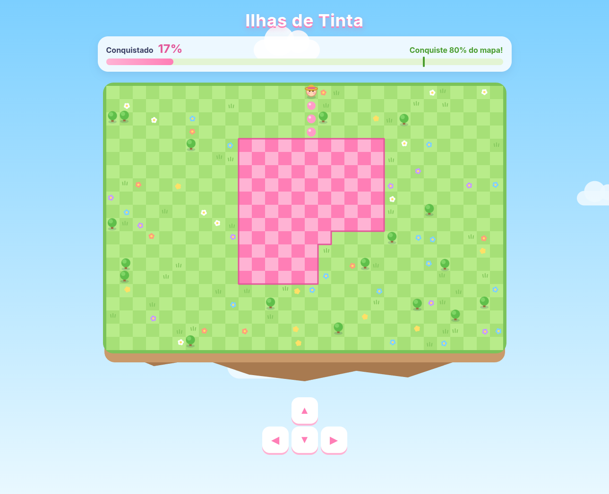
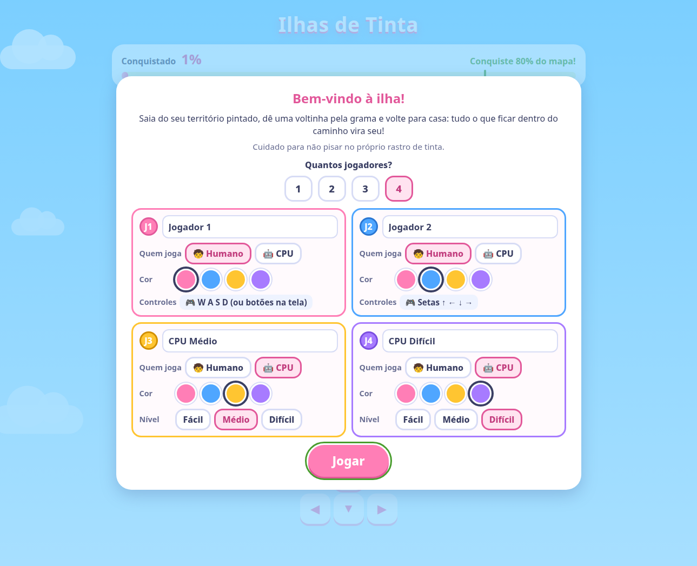
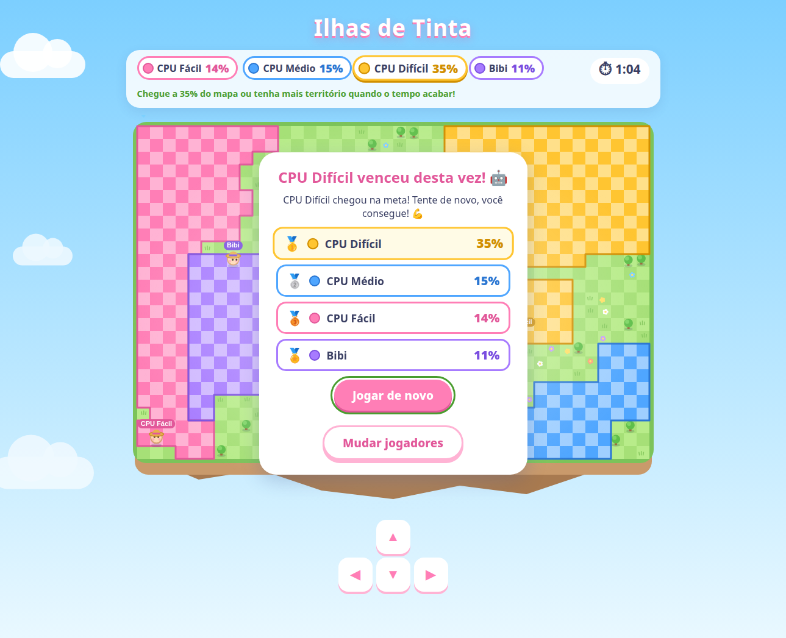

# Ilhas de Tinta

Jogo infantil de navegador, 2D, de conquista de território. Um pequeno
explorador de chapéu anda por uma ilha flutuante quadriculada. Quando sai do
território pintado, ele deixa um rastro de tinta; ao voltar para casa fechando
uma área, tudo o que ficou dentro do caminho vira território dele.

Dá para jogar **sozinho** (meta: 80% do mapa) ou com **2 a 4 jogadores** no
mesmo computador, misturando humanos e CPUs com três níveis de dificuldade.




## Como executar

Não precisa instalar nada: é só HTML, CSS e JavaScript puro, sem dependências
e sem imagens externas.

- **Jeito mais fácil:** dê um duplo clique em `index.html`.
- **Com um servidor local** (opcional):

  ```sh
  python3 -m http.server
  ```

  e abra <http://localhost:8000> no navegador.

## Modos de jogo

Ao abrir o jogo aparece a **tela de configuração**:

1. Escolha quantos jogadores: **1, 2, 3 ou 4**.
2. Para cada vaga escolha **Humano** ou **CPU**, a **cor** (rosa, azul,
   amarelo ou roxo — sem repetir; escolher uma cor já usada troca as duas) e,
   se quiser, mude o **nome** ("Jogador 1", "CPU Fácil"...).
3. Para a CPU, escolha o nível: **Fácil**, **Médio** ou **Difícil**.
4. Aperte **Jogar** (ou Enter).



### Solo (1 jogador)

É o modo de sempre: mapa 30x20, começa no centro, meta de **80%**, sem relógio.

### 2 a 4 jogadores

| Jogadores | Mapa | Onde cada um começa | Meta antecipada |
| --- | --- | --- | --- |
| 2 | 32x20 | lados esquerdo e direito | 50% |
| 3 | 40x26 | cantos | 35% |
| 4 | 40x26 | cantos | 35% |

- A partida dura **2 minutos** (relógio no HUD) ou acaba antes se alguém
  atingir a meta. **Ganha quem tiver mais território.**
- O HUD mostra a porcentagem de cada jogador, com sua cor e nome, e o tempo.
- A tela final mostra o ranking com medalhas, **Jogar de novo** (mesma
  configuração) e **Mudar jogadores** (volta para a configuração).



Os números (tamanhos, metas, tempo) ficam em `js/config.js`.

## Controles

| Vaga | Teclas |
| --- | --- |
| J1 | **W A S D** |
| J2 | **Setas** |
| J3 | **I J K L** |
| J4 | teclado numérico **8 4 5 6** *ou* **T F G H** (para quem não tem teclado numérico) |

- Se houver **um único humano** na partida (inclusive no solo), ele pode usar
  **W A S D**, as **setas** ou as teclas da própria vaga.
- Os **botões na tela** (▲ ◀ ▼ ▶) controlam o único humano, ou o primeiro
  humano quando há vários.
- **Enter** ou **Espaço** começam a partida / jogam de novo.

## Regras

- O explorador anda sozinho, célula a célula; a tecla escolhe a próxima direção.
- Não dá para dar meia-volta (180°). A borda do mapa faz o explorador parar.
- Fora do próprio território (na grama ou no território de outro jogador),
  cada célula visitada vira **rastro**.
- Voltando ao território, o rastro vira território e toda área cercada também
  — **inclusive território de outros jogadores**.
- **Pisou no próprio rastro?** Nada de "perder": o rastro some, o explorador
  volta ao último ponto seguro e aparece um "Ops! Tente de novo".
- **Encostou no rastro de outro jogador?** O rastro dele é cortado: o rastro
  dele some e ele volta para o território dele ("✂️ Ana cortou o rastro de Beto!").
- Dois exploradores na mesma célula: nada acontece.
- Ninguém é eliminado: quem perde todo o território ganha uma ilhinha nova 3x3
  no lugar onde começou.

## A CPU

| Nível | Velocidade | Como joga |
| --- | --- | --- |
| Fácil | 60% | voltas pequenas e, às vezes, vira para um lado qualquer |
| Médio | 72% | voltas médias; volta para casa se o rastro ficar longo ou se alguém chegar perto |
| Difícil | 78% | compara várias voltas e escolhe a maior e mais segura; persegue rastros de adversários que estejam perto (com uma pausa entre uma caçada e outra) |

A CPU planeja voltas em forma de retângulo e, a cada passo, só aceita
direções que ainda têm um caminho de volta para casa sem cruzar o próprio
rastro (busca em largura). Por isso os níveis Médio e Difícil nunca pisam no
próprio rastro por descuido. A CPU é sempre um pouco mais lenta que um humano,
para continuar vencível por uma criança.

## Como o código está organizado

Os scripts são `<script>` clássicos (não módulos ES) para o jogo abrir direto
em `file://`. Tudo fica no namespace global `window.IlhasDeTinta`.

```
index.html            página, canvas, HUD e telas (configuração / fim)
css/style.css         visual da página e da interface (céu, nuvens, HUD, botões)
js/config.js          constantes: tamanhos de mapa, cores dos jogadores, níveis da CPU,
                      controles de cada vaga, velocidade, metas e tempo
js/grid.js            estado do mapa (dono e rastro por célula), captura por flood fill,
                      porcentagem por jogador e busca de caminho (BFS)
js/player.js          o explorador: posição, direção, movimento célula a célula
js/input.js           teclado (um esquema por vaga) + botões direcionais na tela
js/renderer.js        desenho da ilha, decoração, territórios, rastros, exploradores e confete
js/ui.js              HUD (solo e multi), relógio, mensagens e tela de fim com ranking
js/ai.js              a CPU (Fácil, Médio, Difícil)
js/setup.js           tela de configuração dos jogadores
js/game.js            loop (requestAnimationFrame), regras e estados:
                      configuração → jogando → fim
tests/captura.html    testes da captura de área (abra no navegador)
tests/simulacao.html  partidas automáticas com CPUs + teste dos controles
docs/screenshots/     capturas de tela
```

### Como funciona a captura

Cada célula guarda o **dono** (0 = grama, 1 a 4 = jogador) e o **rastro**
(0 = nenhum, 1 a 4 = jogador). Quando o jogador *N* volta ao território com
rastro (`Grade.capturar(N)` em `js/grid.js`):

1. todo o rastro de *N* vira território de *N*;
2. um flood fill (busca em largura) parte das bordas do mapa e anda só por
   células que **não** são de *N* (território de outros não é parede);
3. toda célula que não é de *N* e não foi alcançada está cercada, então vira
   de *N* — mesmo que fosse de outro jogador.

### Testes

- `tests/captura.html` — abra no navegador (funciona com duplo clique). Testa
  área simples, forma em L, captura encostada na borda, área aberta para a
  borda, rastro que não fecha área, tomada de território de outro jogador,
  rastro por cima do território alheio, busca de caminho etc.
- `tests/simulacao.html` — precisa do servidor local
  (`python3 -m http.server` e abrir <http://localhost:8000/tests/simulacao.html>).
  Confere os controles de cada vaga e roda partidas aceleradas (1 humano
  parado + CPU de cada nível, 3 e 4 CPUs): a partida precisa terminar, sem
  erros, e as CPUs Médio e Difícil não podem pisar no próprio rastro.

A página fica verde quando tudo passa.

### Ajustes rápidos

Em `js/config.js` dá para mudar os tamanhos de mapa, a velocidade, as cores,
as metas e o tempo. Para testar o fim rapidinho, no console do navegador
(antes de apertar Jogar):

```js
IlhasDeTinta.config.META = 0.05;          // solo
IlhasDeTinta.config.META_MULTI[2] = 0.05; // 2 jogadores
IlhasDeTinta.config.TEMPO_LIMITE = 15;    // partida de 15 segundos
```

## Limitações conhecidas

- A borda do mapa não funciona como parede na captura: uma área só é capturada
  se ficar totalmente cercada pelo território (como pede a regra do flood fill
  a partir das bordas). Para conquistar perto da borda, o rastro precisa passar
  pelas células da própria borda.
- Com 3 ou 4 jogadores no mesmo teclado, alguns teclados não registram muitas
  teclas apertadas ao mesmo tempo (limitação do hardware, "ghosting").
- Em telas de celular o mapa encolhe para caber na largura, então as células
  ficam pequenas; o modo com vários humanos foi pensado para teclado.
- Se dois exploradores entram na mesma célula com rastro, ninguém é cortado;
  o rastro de quem chegou depois fica com um "buraco" naquela célula, o que
  pode deixar escapar a captura daquela volta (caso raro).
- O equilíbrio da CPU foi ajustado por simulação, não com crianças de
  verdade: pode ser preciso mexer nas velocidades em `js/config.js`.
- Sem sons, inimigos, power-ups ou fases extras: é um protótipo só com o básico.
