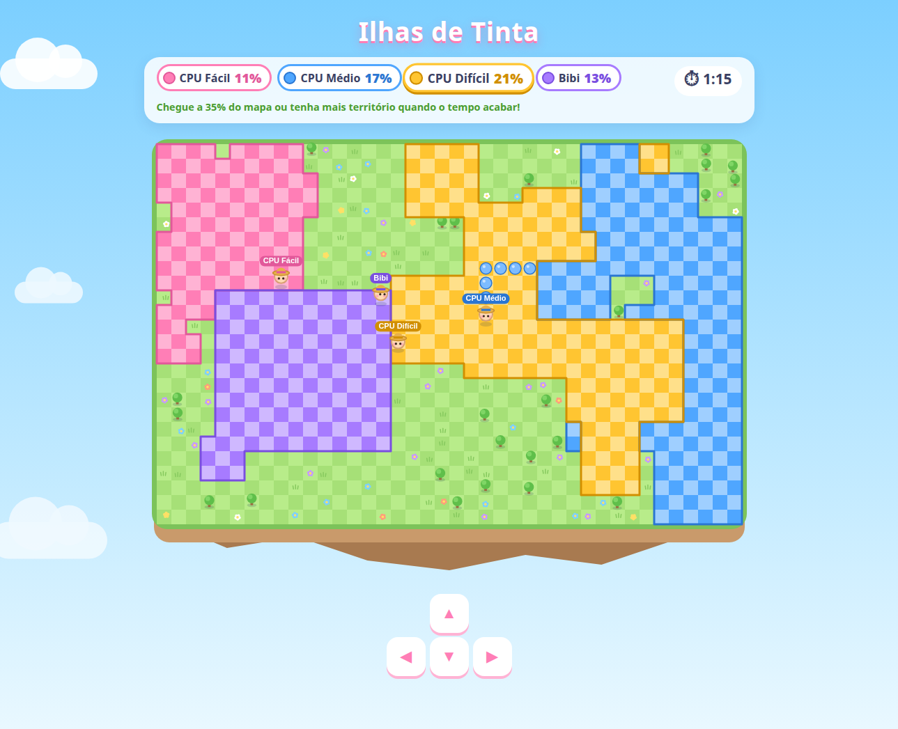
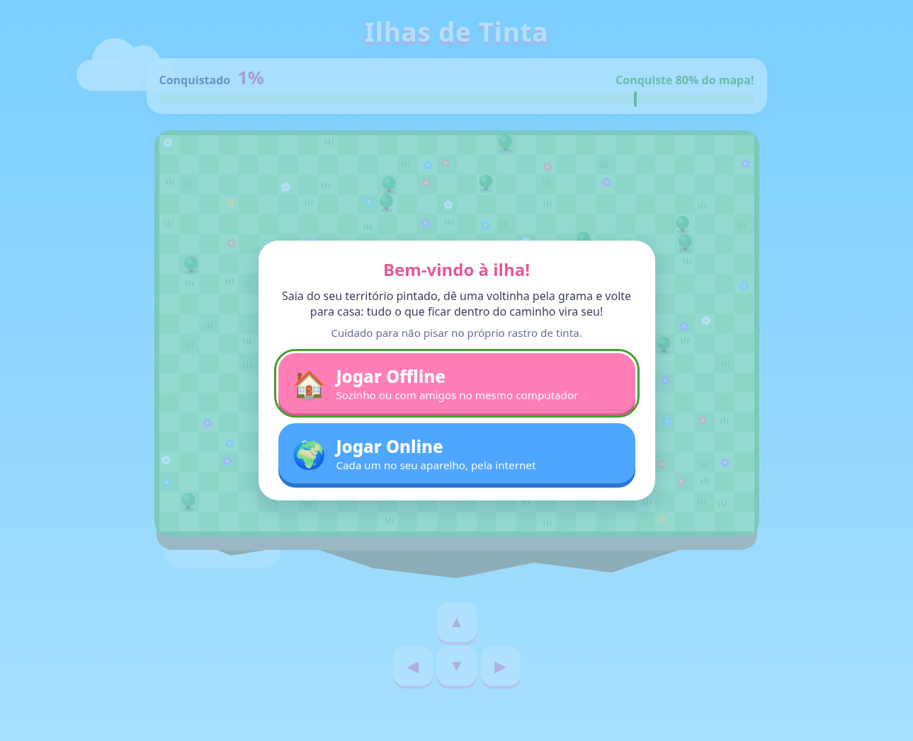
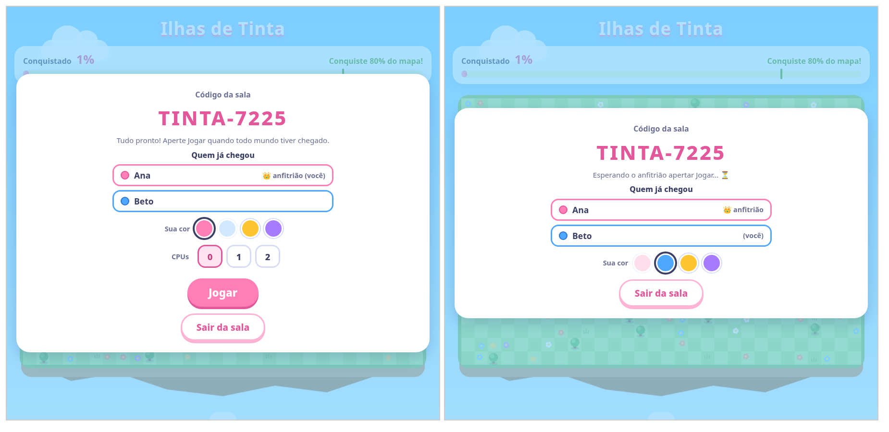

# Ilhas de Tinta

Jogo infantil de navegador, 2D, de conquista de território. Um pequeno
explorador de chapéu anda por uma ilha flutuante quadriculada. Quando sai do
território pintado, ele deixa um rastro de tinta; ao voltar para casa fechando
uma área, tudo o que ficou dentro do caminho vira território dele.

Dá para jogar **Offline** — sozinho (meta: 80% do mapa) ou com **2 a 4
jogadores** no mesmo computador, misturando humanos e CPUs com três níveis de
dificuldade — ou **Online**, cada um no seu aparelho, numa sala com código.
Depois da primeira visita ao site, o jogo abre e o modo Offline funciona
**mesmo sem internet**.




## Como executar

Não precisa instalar nada nem compilar: é só HTML, CSS e JavaScript puro.
A única biblioteca (supabase-js, para o online) fica copiada em `js/vendor/`.

- **Jeito mais fácil:** dê um duplo clique em `index.html`. Funciona o modo
  Offline; o Online avisa que precisa do site (http/https).
- **Com um servidor local** (Offline + Online + funcionar sem internet):

  ```sh
  python3 -m http.server
  ```

  e abra <http://localhost:8000> no navegador.
- **No ar:** é um site estático; dá para publicar como está (por exemplo na
  Vercel — o `vercel.json` só ajusta o cache do `sw.js`).



## Modos de jogo

A primeira tela é o **menu**: **Jogar Offline** ou **Jogar Online**.

### Offline

Em "Jogar Offline" aparece a **tela de configuração**:

1. Escolha quantos jogadores: **1, 2, 3 ou 4**.
2. Para cada vaga escolha **Humano** ou **CPU**, a **cor** (rosa, azul,
   amarelo ou roxo — sem repetir; escolher uma cor já usada troca as duas) e,
   se quiser, mude o **nome** ("Jogador 1", "CPU Fácil"...).
3. Para a CPU, escolha o nível: **Fácil**, **Médio** ou **Difícil**.
4. Aperte **Jogar** (ou Enter).


#### Solo (1 jogador)

É o modo de sempre: mapa 30x20, começa no centro, meta de **80%**, sem relógio.

#### 2 a 4 jogadores

| Jogadores | Mapa | Onde cada um começa | Meta antecipada |
| --- | --- | --- | --- |
| 2 | 32x20 | lados esquerdo e direito | 50% |
| 3 | 40x26 | cantos | 35% |
| 4 | 40x26 | cantos | 35% |

- A partida dura **2 minutos** (relógio no HUD) ou acaba antes se alguém
  atingir a meta. **Ganha quem tiver mais território.**
- O HUD mostra a porcentagem de cada jogador, com sua cor e nome, e o tempo.
- A tela final mostra o ranking com medalhas, **Jogar de novo** (mesma
  configuração) e **Mudar jogadores** (volta para a configuração).


Os números (tamanhos, metas, tempo) ficam em `js/config.js`.

### Online

1. Toque em **Jogar Online** e escreva seu nome.
2. Quem vai ser o **anfitrião** toca em **Criar sala**. Aparece um código
   fácil de ditar, como **TINTA-4821**.
3. Os amigos tocam em **Entrar**, digitam o código (pode ser só `4821`) e
   pronto: todos aparecem na lista da sala, cada um com sua cor. Cada um pode
   trocar para uma cor que esteja livre.
4. O anfitrião pode completar as vagas vazias com **CPU** (e escolher o nível)
   e aperta **Jogar**. São de 2 a 4 jogadores no total.
5. Cada um joga no próprio aparelho com **W A S D**, **setas** ou os **botões
   na tela**.
6. No fim aparece o ranking. O anfitrião escolhe **Jogar de novo** ou **Voltar
   para a sala**; os outros esperam ou saem.

- Se o **anfitrião sair**, todos voltam ao menu com um aviso.
- Se outro jogador **sair no meio da partida**, o explorador dele passa a ser
  jogado pela **CPU (nível Médio)** até o fim, para a partida continuar justa.
- Sem internet, abrindo o arquivo direto (file://) ou se o Supabase não
  responder, aparece uma mensagem amigável e dá para voltar e jogar Offline.




#### Como o online funciona

Não existe servidor do jogo nem banco de dados. Usamos só o **Supabase
Realtime** (canais **Broadcast** e **Presence**) para repassar mensagens:

- O navegador de quem **cria a sala** é o **anfitrião**: ele roda a partida de
  verdade, com o mesmo código do modo offline (inclusive as CPUs).
- Os outros aparelhos só mandam **mudanças de direção** quando o jogador aperta
  uma tecla.
- O anfitrião manda **10 mensagens por segundo** com as posições, o relógio e
  só as **células que mudaram**; a cada **3 segundos** manda uma **foto
  completa** do mapa (e também quando alguém perde mensagens).
- Os outros aparelhos desenham o que chega e **interpolam** o movimento entre
  uma mensagem e outra, para ficar suave.
- **Presence** mostra quem está na sala e avisa quando alguém entra ou sai.

A URL do projeto e a chave **publicável** do Supabase ficam em `js/config.js`
(seção `ONLINE`); essa chave é pública por design. Não há login, chat nem
pagamento.

#### Limites do plano grátis do Supabase (estimativa)

Confira os números atuais em <https://supabase.com/docs/guides/realtime/limits>
— na época em que isto foi escrito, o plano grátis do Realtime permitia cerca de
**200 conexões simultâneas**, **2 milhões de mensagens por mês** e **100
mensagens por segundo** no projeto todo. O Supabase conta cada mensagem
**recebida** por cada aparelho.

| Partida de 2 min | Mensagens por segundo | Mensagens por partida | Partidas por mês (2 mi) |
| --- | --- | --- | --- |
| 2 humanos online | ~20 | ~2.700 | ~700 |
| 4 humanos online | ~40 | ~6.000 | ~330 |

(Anfitrião: 10/s × 120 s = 1.200 envios, recebidos por cada um dos outros;
mais as teclas, que todos recebem.) Com 100 mensagens/s no projeto todo, cabem
umas **2 salas cheias (4 jogadores) ao mesmo tempo**, ou umas 5 salas de 2.
Para caber mais salas, diminua `ENVIOS_POR_SEGUNDO` em `js/config.js` (fica um
pouco menos suave) ou mude de plano.

## Funcionar sem internet

Quando o jogo é aberto por um endereço http/https, o `sw.js` (service worker)
guarda **todos os arquivos do jogo** no aparelho. Depois da primeira visita, o
site abre e o modo **Offline** funciona sem internet. O `manifest.webmanifest`
e os ícones em `icones/` permitem "instalar" o jogo na tela inicial.

**Ao publicar uma versão nova, aumente `VERSAO` no `sw.js`** (ex.:
`ilhas-de-tinta-v2`): o navegador baixa os arquivos novos e apaga o cache
antigo. O `vercel.json` faz o `sw.js` nunca ficar em cache no servidor, para a
atualização chegar.

## Controles

| Vaga | Teclas |
| --- | --- |
| J1 | **W A S D** |
| J2 | **Setas** |
| J3 | **I J K L** |
| J4 | teclado numérico **8 4 5 6** *ou* **T F G H** (para quem não tem teclado numérico) |

- **Online:** cada um usa **W A S D**, **setas** ou os **botões na tela** no
  próprio aparelho.
- Se houver **um único humano** na partida (inclusive no solo), ele pode usar
  **W A S D**, as **setas** ou as teclas da própria vaga.
- Os **botões na tela** (▲ ◀ ▼ ▶) controlam o único humano, ou o primeiro
  humano quando há vários.
- **Enter** ou **Espaço** começam a partida / jogam de novo.

## Regras

- O explorador anda sozinho, célula a célula; a tecla escolhe a próxima direção.
- Não dá para dar meia-volta (180°). A borda do mapa faz o explorador parar.
- Fora do próprio território (na grama ou no território de outro jogador),
  cada célula visitada vira **rastro**.
- Voltando ao território, o rastro vira território e toda área cercada também
  — **inclusive território de outros jogadores**.
- **Pisou no próprio rastro?** Nada de "perder": o rastro some, o explorador
  volta ao último ponto seguro e aparece um "Ops! Tente de novo".
- **Encostou no rastro de outro jogador?** O rastro dele é cortado: o rastro
  dele some e ele volta para o território dele ("✂️ Ana cortou o rastro de Beto!").
- Dois exploradores na mesma célula: nada acontece.
- Ninguém é eliminado: quem perde todo o território ganha uma ilhinha nova 3x3
  no lugar onde começou.

## A CPU

| Nível | Velocidade | Como joga |
| --- | --- | --- |
| Fácil | 60% | voltas pequenas e, às vezes, vira para um lado qualquer |
| Médio | 72% | voltas médias; volta para casa se o rastro ficar longo ou se alguém chegar perto |
| Difícil | 78% | compara várias voltas e escolhe a maior e mais segura; persegue rastros de adversários que estejam perto (com uma pausa entre uma caçada e outra) |

A CPU planeja voltas em forma de retângulo e, a cada passo, só aceita
direções que ainda têm um caminho de volta para casa sem cruzar o próprio
rastro (busca em largura). Por isso os níveis Médio e Difícil nunca pisam no
próprio rastro por descuido. A CPU é sempre um pouco mais lenta que um humano,
para continuar vencível por uma criança.

## Como o código está organizado

Os scripts são `<script>` clássicos (não módulos ES) para o jogo abrir direto
em `file://`. Tudo fica no namespace global `window.IlhasDeTinta`.

```
index.html            página, canvas, HUD e telas (configuração / fim)
css/style.css         visual da página e da interface (céu, nuvens, HUD, botões)
js/config.js          constantes: tamanhos de mapa, cores dos jogadores, níveis da CPU,
                      controles de cada vaga, velocidade, metas e tempo
js/grid.js            estado do mapa (dono e rastro por célula), captura por flood fill,
                      porcentagem por jogador e busca de caminho (BFS)
js/player.js          o explorador: posição, direção, movimento célula a célula
js/input.js           teclado (um esquema por vaga) + botões direcionais na tela
js/renderer.js        desenho da ilha, decoração, territórios, rastros, exploradores e confete
js/ui.js              HUD (solo e multi), relógio, mensagens e tela de fim com ranking
js/ai.js              a CPU (Fácil, Médio, Difícil)
js/setup.js           tela de configuração dos jogadores (offline)
js/online.js          modo online: salas, Presence, anfitrião e sincronização
js/vendor/            supabase-js 2.119.0 (cópia local, versão fixa)
sw.js                 service worker (cache para funcionar sem internet)
manifest.webmanifest  dados para instalar o jogo como aplicativo
icones/               ícones do jogo (SVG e PNG)
vercel.json           cabeçalhos de cache para a hospedagem
js/game.js            loop (requestAnimationFrame), regras e estados:
                      menu → configuração/online/sala → jogando → fim
tests/captura.html    testes da captura de área (abra no navegador)
tests/simulacao.html  partidas automáticas com CPUs + teste dos controles
tests/online.html     teste online de ponta a ponta (2 ou 4 janelas, Supabase real)
docs/screenshots/     capturas de tela
```

### Como funciona a captura

Cada célula guarda o **dono** (0 = grama, 1 a 4 = jogador) e o **rastro**
(0 = nenhum, 1 a 4 = jogador). Quando o jogador *N* volta ao território com
rastro (`Grade.capturar(N)` em `js/grid.js`):

1. todo o rastro de *N* vira território de *N*;
2. um flood fill (busca em largura) parte das bordas do mapa e anda só por
   células que **não** são de *N* (território de outros não é parede);
3. toda célula que não é de *N* e não foi alcançada está cercada, então vira
   de *N* — mesmo que fosse de outro jogador.

### Testes

- `tests/captura.html` — abra no navegador (funciona com duplo clique). Testa
  área simples, forma em L, captura encostada na borda, área aberta para a
  borda, rastro que não fecha área, tomada de território de outro jogador,
  rastro por cima do território alheio, busca de caminho etc.
- `tests/simulacao.html` — precisa do servidor local
  (`python3 -m http.server` e abrir <http://localhost:8000/tests/simulacao.html>).
  Confere os controles de cada vaga e roda partidas aceleradas (1 humano
  parado + CPU de cada nível, 3 e 4 CPUs): a partida precisa terminar, sem
  erros, e as CPUs Médio e Difícil não podem pisar no próprio rastro.

- `tests/online.html` — precisa do servidor local **e de internet**
  (<http://localhost:8000/tests/online.html>, ou `?jogadores=4`). Abre o jogo
  em 2 ou 4 janelinhas, cada uma como um aparelho: cria a sala, entra pelo
  código, troca de cor, completa com CPU, joga até o ranking (confere que o
  mapa e o ranking são iguais em todas as janelas), "Jogar de novo", um
  jogador saindo no meio (vira CPU) e o anfitrião saindo (todos voltam ao menu).

A página fica verde quando tudo passa.

### Ajustes rápidos

Em `js/config.js` dá para mudar os tamanhos de mapa, a velocidade, as cores,
as metas e o tempo. Para testar o fim rapidinho, no console do navegador
(antes de apertar Jogar):

```js
IlhasDeTinta.config.META = 0.05;          // solo
IlhasDeTinta.config.META_MULTI[2] = 0.05; // 2 jogadores
IlhasDeTinta.config.TEMPO_LIMITE = 15;    // partida de 15 segundos
```

## Limitações conhecidas

- **Online — o anfitrião precisa ficar com o jogo aberto e visível.** Se a aba
  do anfitrião for para o fundo (ou a tela do celular apagar), o navegador
  desacelera a página e a partida fica lenta para todos.
- **Online — atraso:** a direção de quem não é anfitrião chega ao anfitrião com
  o atraso da internet (normalmente 50–150 ms), então a virada pode acontecer
  uma célula depois. O anfitrião não tem atraso.
- **Online — confiança:** como o anfitrião simula tudo no navegador dele, quem
  souber mexer no console poderia trapacear. Para um jogo entre amigos e
  família isso é aceitável.
- **Online — quem chega no meio** de uma partida espera na sala e entra na
  próxima. Quem sai e volta entra como um jogador novo.
- **Online — limites do plano grátis** (veja a tabela acima): cerca de 2 salas
  cheias ao mesmo tempo.
- **Sem internet:** só funciona depois de abrir o site uma vez com internet; o
  modo Online sempre precisa de internet. Ao atualizar o jogo é preciso
  aumentar `VERSAO` no `sw.js`.

- A borda do mapa não funciona como parede na captura: uma área só é capturada
  se ficar totalmente cercada pelo território (como pede a regra do flood fill
  a partir das bordas). Para conquistar perto da borda, o rastro precisa passar
  pelas células da própria borda.
- Com 3 ou 4 jogadores no mesmo teclado, alguns teclados não registram muitas
  teclas apertadas ao mesmo tempo (limitação do hardware, "ghosting").
- Em telas de celular o mapa encolhe para caber na largura, então as células
  ficam pequenas; o modo com vários humanos foi pensado para teclado.
- Se dois exploradores entram na mesma célula com rastro, ninguém é cortado;
  o rastro de quem chegou depois fica com um "buraco" naquela célula, o que
  pode deixar escapar a captura daquela volta (caso raro).
- O equilíbrio da CPU foi ajustado por simulação, não com crianças de
  verdade: pode ser preciso mexer nas velocidades em `js/config.js`.
- Sem sons, inimigos, power-ups ou fases extras: é um protótipo só com o básico.
