# Ilhas de Tinta

Jogo infantil de navegador, 2D, de conquista de território. Um pequeno
explorador de chapéu anda por uma ilha flutuante quadriculada. Quando sai do
território pintado, ele deixa um rastro de tinta; ao voltar para casa fechando
uma área, tudo o que ficou dentro do caminho vira território dele.

Dá para jogar **Offline** — sozinho (meta: 80% do mapa) ou com **2 a 4
jogadores** no mesmo computador, misturando humanos e CPUs com três níveis de
dificuldade — ou **Online**, cada um no seu aparelho, numa sala com código.
Depois da primeira visita ao site, o jogo abre e o modo Offline funciona
**mesmo sem internet**.


## Como executar

Não precisa instalar nada nem compilar: é só HTML, CSS e JavaScript puro.
A única biblioteca (supabase-js, para o online) fica copiada em `js/vendor/`.

- **Jeito mais fácil:** dê um duplo clique em `index.html`. Funciona o modo
  Offline; o Online avisa que precisa do site (http/https).
- **Com um servidor local** (Offline + Online + funcionar sem internet):

  ```sh
  python3 -m http.server
  ```

  e abra <http://localhost:8000> no navegador.
- **No ar:** é um site estático; dá para publicar como está (por exemplo na
  Vercel — o `vercel.json` só ajusta o cache do `sw.js`).


## Modos de jogo

A primeira tela é o **menu**: **Jogar Offline** ou **Jogar Online**.

### Offline

Em "Jogar Offline" aparece a **tela de configuração**:

1. Escolha quantos jogadores: **1, 2, 3 ou 4**.
2. Para cada vaga escolha **Humano** ou **CPU**, a **cor** (rosa, azul,
   amarelo ou roxo — sem repetir; escolher uma cor já usada troca as duas) e,
   se quiser, mude o **nome** ("Jogador 1", "CPU Fácil"...).
3. Para a CPU, escolha o nível: **Fácil**, **Médio** ou **Difícil**.
4. Aperte **Jogar** (ou Enter).


#### Solo (1 jogador)

É o modo de sempre: mapa 30x20, começa no centro, meta de **80%**, sem relógio.

#### 2 a 4 jogadores

| Jogadores | Mapa | Onde cada um começa | Meta antecipada |
| --- | --- | --- | --- |
| 2 | 32x20 | lados esquerdo e direito | 50% |
| 3 | 40x26 | cantos | 35% |
| 4 | 40x26 | cantos | 35% |

- A partida dura **2 minutos** (relógio no HUD) ou acaba antes se alguém
  atingir a meta. **Ganha quem tiver mais território.**
- O HUD mostra a porcentagem de cada jogador, com sua cor e nome, e o tempo.
- A tela final mostra o ranking com medalhas, **Jogar de novo** (mesma
  configuração) e **Mudar jogadores** (volta para a configuração).


Os números (tamanhos, metas, tempo) ficam em `js/config.js`.

### Primeira partida guiada

Na primeira vez que alguém aperta **Jogar** no modo offline, começa uma
partida guiada de uns 20 segundos, em 3 passos que só avançam quando a criança
faz a ação: **sair de casa**, **virar** e **voltar para casa** (a casa pisca e
uma casinha pula embaixo dela). No fim, "Muito bem! Só não pise no seu próprio
rastro" e o botão **Vamos jogar!** começa a partida que ela escolheu. Dá para
**Pular** a qualquer momento e rever pelo botão **❓ Como jogar** do menu. Se
pisar no próprio rastro no meio, recomeça com "Tudo bem, tente de novo!". O
aparelho lembra que o tutorial já foi feito.

### Som

Efeitos curtos gerados na hora (Web Audio, sem arquivos de áudio): notinhas
subindo ao **pintar**, "uó-uó" no **Ops!**, "tchic" ao **cortar** o rastro de
alguém, um clique baixinho ao **virar**, **fanfarra** quando você vence e uma
melodia amigável quando a partida acaba. Só tocam os sons de quem joga neste
aparelho. Liga/desliga em **⏸ → 🔊 Som** (fica salvo).

### Online

#### Turma: um link que não muda (sem digitar nada)

Para quem joga sempre com as mesmos amigos:

1. Em **Jogar Online**, toque em **👭 Criar uma turma**, escolha um nome (por
   exemplo "Gatinhas") e toque em **✨ Criar turma**. Você vira o anfitrião.
2. Na sala, **🔗 Mandar link da turma** abre o compartilhar do celular (ou
   copia no computador) com um texto pronto para o WhatsApp e um link fixo como
   `https://ilhas-de-tinta.vercel.app/?turma=gatinhas-k7m2x`. O final é
   sorteado (5 letras e números, sem os que confundem, como 0/o e 1/l), para
   ninguém de fora adivinhar.
3. **📱 Mostrar QR** mostra um QR grande desse link para os amigos lerem com a
   câmera. O QR é desenhado no próprio aparelho
   (`js/vendor/qrcode-generator-1.4.4.js`), sem nenhum serviço de fora; ele
   também existe na sala avulsa, com o link `?sala=`.
4. **O link vale sempre** e leva sempre à **mesma sala**:
   - quem chega primeiro vira o anfitrião;
   - quem chega depois entra direto na sala de espera;
   - se a partida já começou, a pessoa assiste e joga a próxima;
   - se todo mundo saiu, quem abrir o link de novo cria a sala outra vez.

   Valem também troca de anfitrião, reconexão e revanche, como em qualquer sala.
5. Cada aparelho **guarda as turmas que já usou**. Elas aparecem no topo de
   **Jogar Online** como botões grandes, **"👭 Jogar com a turma Gatinhas"**:
   um toque e entra. O ✕ tira uma turma da lista (o link continua valendo).

**Nome e cor lembrados.** O aparelho guarda o apelido e a última cor escolhida.
- **Com o nome já lembrado**, abrir o link da turma, o link `?sala=` ou o QR
  **entra direto**, sem pedir nada. Escolhemos isso porque é o mais simples
  para crianças: não há tela nem botão a mais.
- **Sem nome lembrado** (primeira vez no aparelho), aparece só "Seu nome" e
  um botão "Entrar na turma Gatinhas".
- Na sala, **✏️ trocar** muda o nome (todos veem na hora, e o novo nome fica
  lembrado).
- Se a cor preferida estiver ocupada, o jogo escolhe outra livre sozinho.

**App instalado / tela inicial.**
- Abrir a página da turma troca o manifest do app por um da turma: nome
  "Ilhas de Tinta · turma Gatinhas", com `start_url` no link da turma. Assim,
  **"Adicionar à tela inicial" a partir do link da turma cria um ícone que abre
  direto nela**.
  - Conferido no Chrome: instalável e sem erros.
  - No iPhone, o Safari costuma usar o endereço da página ao adicionar, que
    também é o link da turma, mas isso não foi testado num iPhone de verdade.
- Com o app principal instalado, a lista de turmas resolve com um toque.
- No iPhone, o app instalado guarda os dados separados do Safari: a turma
  aparece na lista depois da primeira vez que se entra nela **pelo app**.

**Privacidade.** No aparelho ficam só o apelido, a cor e a lista de turmas
(`localStorage`; se o navegador bloquear, o jogo funciona igual, só não
lembra). Nada vai para banco de dados: o Supabase só repassa as mensagens da
sala, como antes.

**Código da sala.** O campo do código **não aparece mais** em Jogar Online:
- no lugar dele fica só um link pequeno, **"Tenho um código"**, que abre o
  campo;
- o jeito principal de entrar é a turma, o link ou o QR;
- a sala avulsa continua tendo código, porque o `?sala=` e o QR da sala avulsa
  dependem dele;
- quem abre um link `?sala=` já vê o campo aberto e preenchido;
- para mostrar o campo sempre, como antes, mude
  `config.ONLINE.CODIGO_NO_MENU` para `true`.

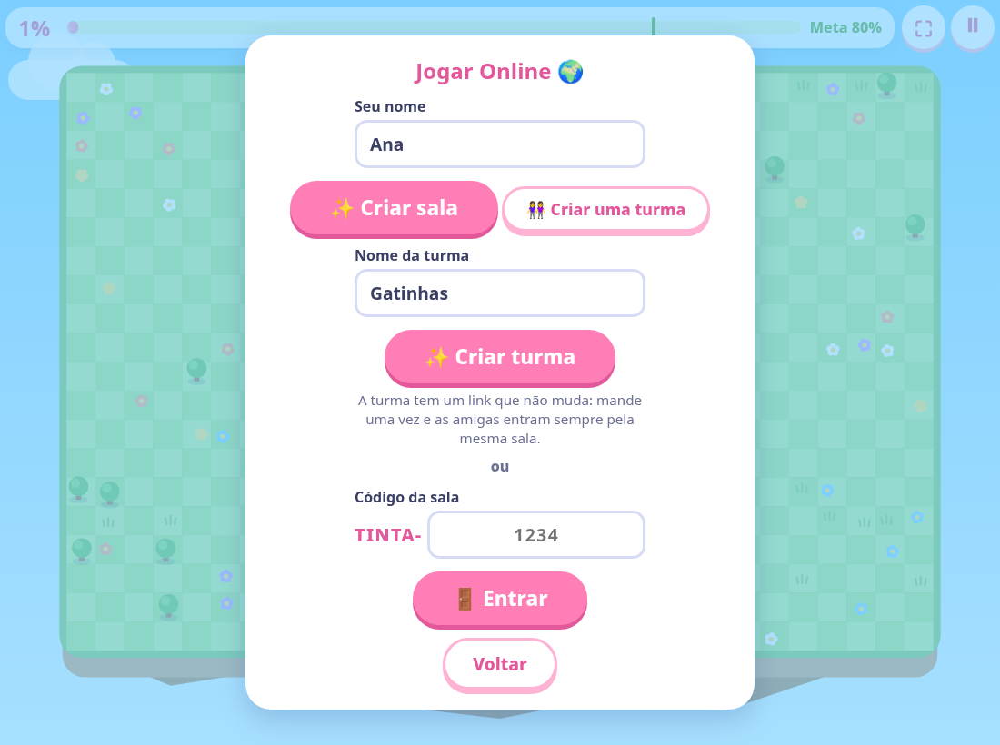
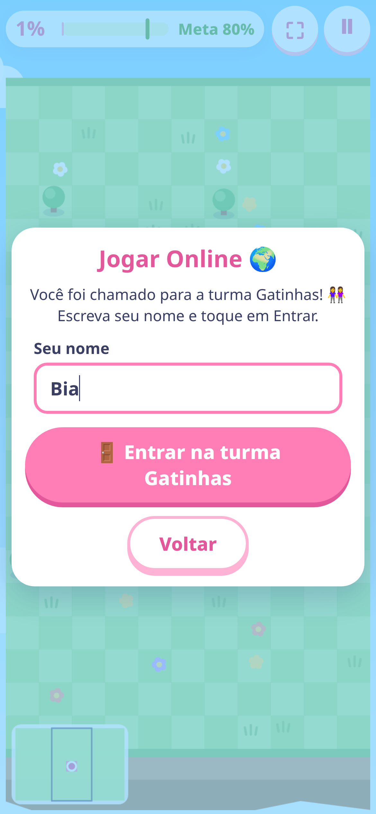
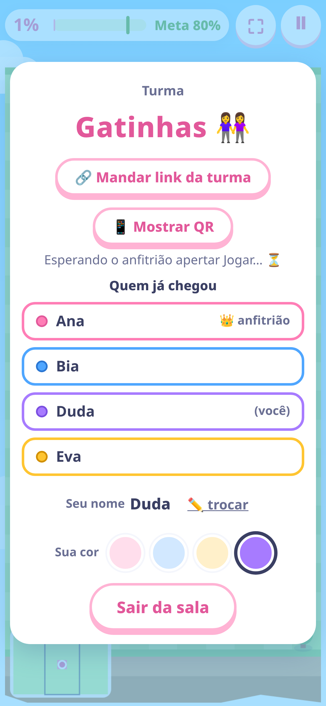
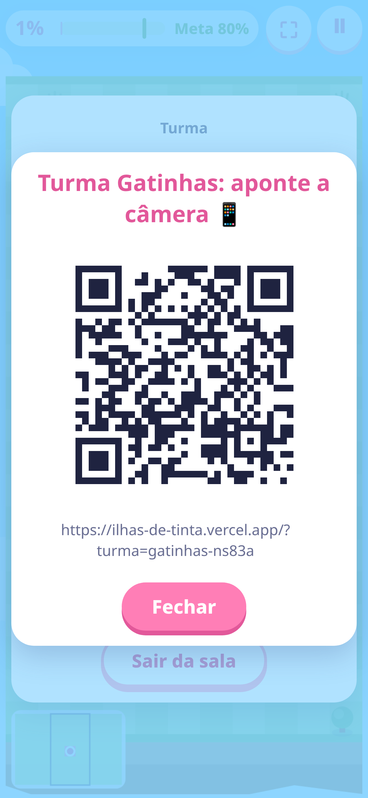
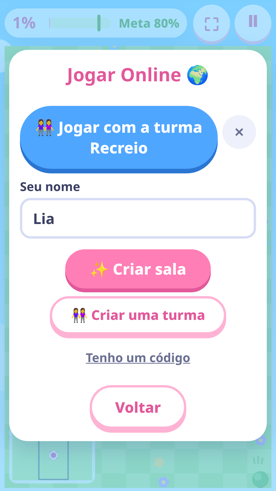
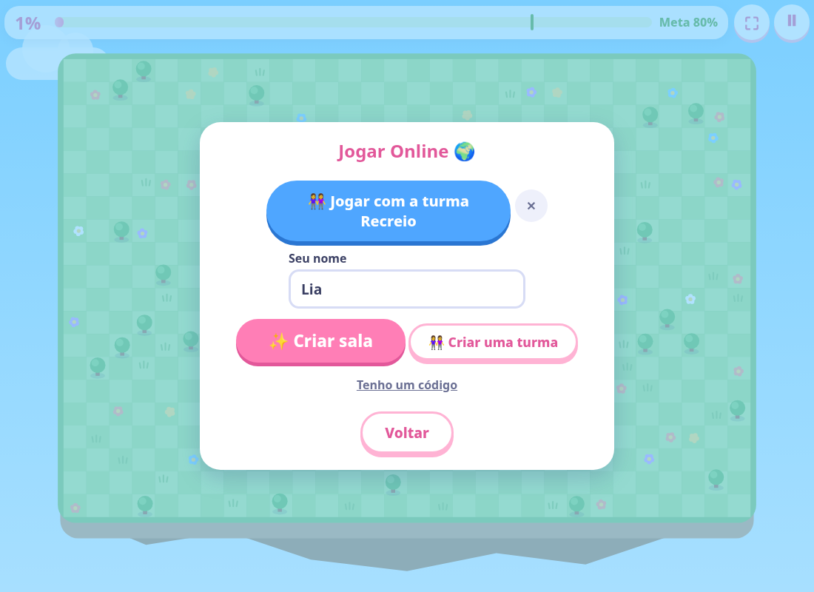

#### Sala avulsa (com código)

1. Toque em **Jogar Online** e escreva seu nome.
2. Quem vai ser o **anfitrião** toca em **Criar sala**. Aparece um código
   fácil de ditar, como **TINTA-4821**.
   Na sala, **🔗 Convidar amigos** compartilha (celular) ou copia (computador)
   um link como `https://ilhas-de-tinta.vercel.app/?sala=4821`: quem abre o
   link já cai na tela online com o código preenchido — é só escrever o nome e
   tocar em **Entrar**. Se o aparelho já lembra o nome, entra direto. Há também
   **📱 Mostrar QR** com o mesmo link.
3. Os amigos tocam em **Tenho um código**, digitam o código (pode ser só
   `4821`), tocam em **Entrar** e
   pronto: todos aparecem na lista da sala, cada um com sua cor. Cada um pode
   trocar para uma cor que esteja livre.
4. O anfitrião pode completar as vagas vazias com **CPU** (e escolher o nível)
   e aperta **Jogar**. São de 2 a 4 jogadores no total.
5. Cada um joga no próprio aparelho com **W A S D**, **setas** ou os **botões
   na tela**.
6. No fim aparece o ranking e **todos** veem **🔁 Revanche**: cada um toca
   para votar ("Querem revanche: Ana, Beto — 2 de 3") e, quando todos os
   humanos votam, outra partida começa sozinha. O anfitrião também pode
   **Voltar para a sala**.

- **Celular e computador jogam juntos**, com qualquer um dos dois como
  anfitrião. Cada aparelho tem a **própria câmera** (o celular segue o seu
  explorador; o computador vê a ilha toda), mas o jogo é o mesmo para todos.
- No celular, o código da sala abre o **teclado de números**; dá para digitar
  só os 4 números (o "TINTA-" já aparece fixo), e colar "TINTA-1234" também
  funciona.
- Se o **anfitrião sai da tela** (bloqueou o celular, trocou de app), a
  partida **pausa** e os outros veem "O anfitrião saiu da tela. Esperando ele
  voltar… ⏳". Quando ele volta, vê a tela de pausa ("O anfitrião pausou o
  jogo") e a partida continua quando ele toca em **Continuar**. Se as
  mensagens do anfitrião param de chegar por 2,5 s (internet lenta), os outros
  veem "Esperando o anfitrião… ⏳". O anfitrião pode pausar pelo ⏸; para os
  outros, o ⏸ só abre o menu (a partida continua).
- **Quedas curtas não derrubam ninguém.** Quando o celular bloqueia ou a aba
  fica oculta, o navegador congela a página e a conexão com o Supabase cai.
  O jogo **reconecta sozinho** com a mesma identidade ("Reconectando… 🔄") —
  na hora em que a pessoa volta, quando a internet volta, ou a cada 4 s — e
  pede o estado completo. Para os outros, quem sumiu fica "**Fulano saiu um
  pouquinho ⏳**" e só conta como saída depois da **tolerância: 30 s na
  partida e 60 s na sala de espera**. Na partida, enquanto isso, a CPU segura
  o explorador e devolve quando a pessoa volta ("Fulano voltou! 🎉").
  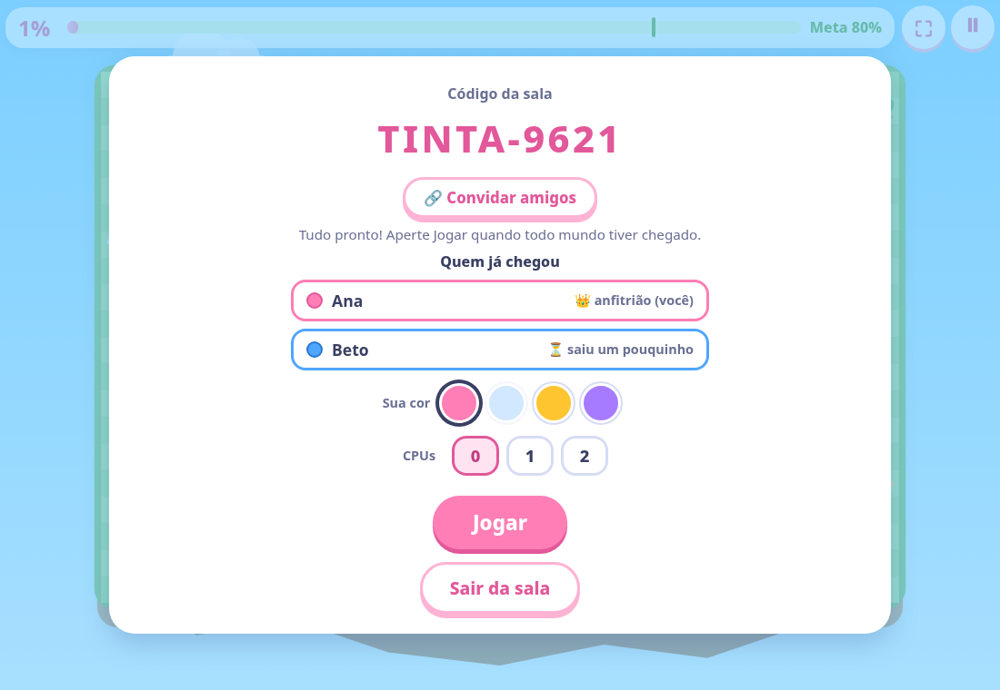
- **Recarregar a página volta para a sala** (código e identidade ficam no
  `sessionStorage` da aba por até 30 min). Quem recarrega no meio da partida
  volta para dentro dela, com o mesmo explorador. Se quem recarregou era o
  anfitrião (e perdeu o jogo, que estava só na memória dele), outro jogador
  assume **na hora** e ele volta como jogador comum. Se ele estava sozinho na
  sala de espera, a sala continua com ele.
- **Chegou no meio da partida?** Entra na sala e **assiste** a partida que
  está acontecendo ("👀 Assistindo! Você entra na próxima partida.") — vê o
  mapa e o ranking, mas não controla ninguém — e joga a partir da próxima
  (revanche ou "Voltar para a sala").
  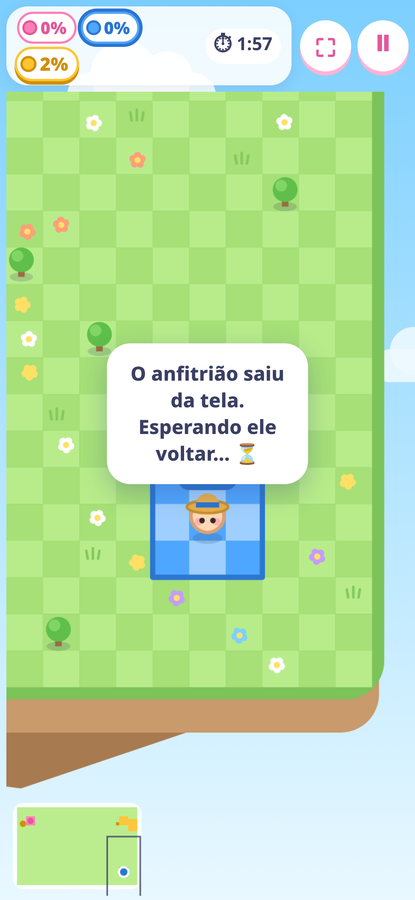
  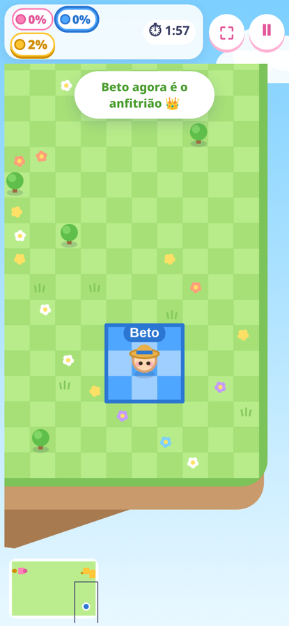
- **Troca de anfitrião:** se o anfitrião **sai da sala** e não volta dentro da
  tolerância (30 s na partida, 60 s na sala de espera), fica **mais de 30 s
  fora da tela** (celular bloqueado) ou **recarrega a página**, o **próximo
  jogador da lista da sala vira o anfitrião** e a partida
  **continua de onde estava** (todos já têm o mapa, as posições e o relógio).
  Aparece "Fulano agora é o anfitrião 👑". O explorador do antigo anfitrião
  passa a ser jogado pela CPU; quando ele volta para a tela, vira jogador
  comum e recebe o explorador de volta. Cada troca tem um número de "eleição"
  e vale sempre a mais nova, então nunca ficam dois anfitriões. Só quando não
  sobra nenhum outro humano a sala acaba e a pessoa volta ao menu.
- Se outro jogador **sair no meio da partida**, o explorador dele passa a ser
  jogado pela **CPU (nível Médio)** até o fim, para a partida continuar justa.
- Sem internet, abrindo o arquivo direto (file://) ou se o Supabase não
  responder, aparece uma mensagem amigável e dá para voltar e jogar Offline.


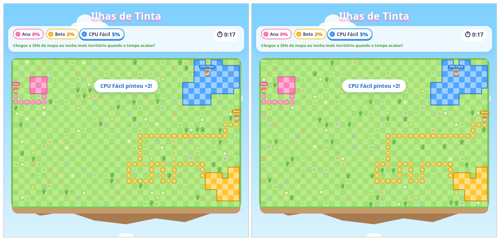
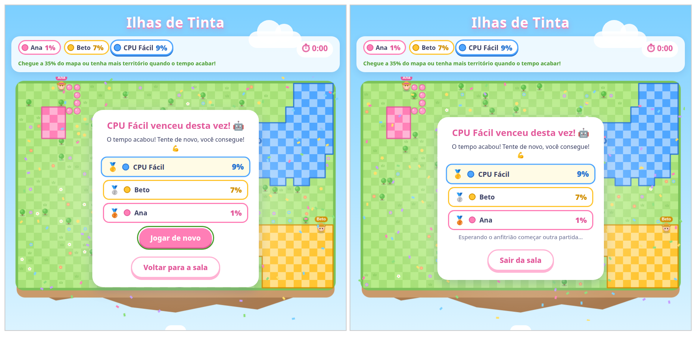
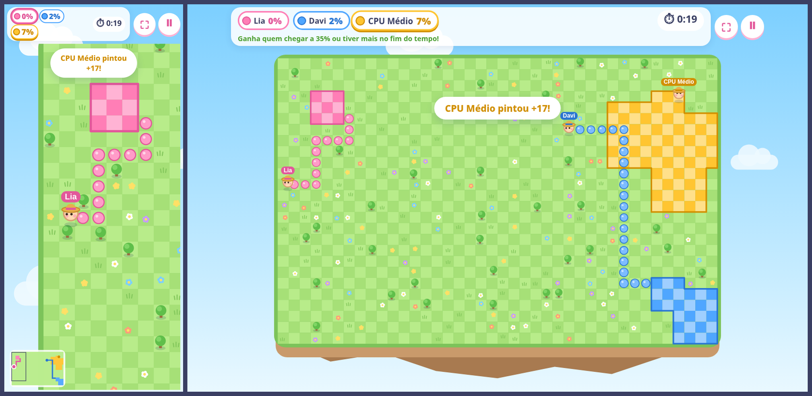

#### Como o online funciona

Não existe servidor do jogo nem banco de dados. Usamos só o **Supabase
Realtime** (canais **Broadcast** e **Presence**) para repassar mensagens:

- O navegador de quem **cria a sala** é o **anfitrião**: ele roda a partida de
  verdade, com o mesmo código do modo offline (inclusive as CPUs).
- Os outros aparelhos só mandam **mudanças de direção** quando o jogador aperta
  uma tecla (segurar a tecla não repete a mensagem), junto com a **célula onde
  querem virar**.
- **Sem atraso na virada (previsão):** quem não é o anfitrião vê o próprio
  explorador andar e virar **na hora**, como no modo offline, e o **rastro**
  dele aparece na hora também (antes, o rastro só aparecia quando o anfitrião
  confirmava, e o personagem parecia "sair correndo" na frente dele). O
  anfitrião aplica a virada **naquela mesma célula**:
  - se a mensagem chega atrasada, ele "rebobina" até 6 células para virar no
    lugar certo;
  - se chega adiantada, guarda a virada até o explorador chegar lá.

  O aparelho confere a previsão com o estado que chega do anfitrião
  ("atrasado", pelo tempo da internet):
  - se o anfitrião está em algum ponto do caminho que o explorador acabou de
    fazer, está certo, e nada muda;
  - só corrige quando diverge de verdade ("Ops!", corte, virada recusada), e
    então desliza até a posição certa em vez de pular.

  Medido com `tests/celular/medir_lag.py`, com internet de casa simulada
  (+80 ms ±60 em cada mensagem) e um celular 4× mais lento, antes → depois:
  - casa sem rastro embaixo do personagem: 53% → 0%;
  - puxões para trás: 28 → 2;
  - correções: 51 → 11.
- O anfitrião manda **6 mensagens por segundo** com as posições, o relógio e
  só as **células que mudaram**; a cada **3 segundos** manda uma **foto
  completa** do mapa (e também quando alguém perde mensagens).
- Os outros aparelhos desenham o que chega e **interpolam** o movimento entre
  uma mensagem e outra, para ficar suave.
- **Presence** mostra quem está na sala e avisa quando alguém entra ou sai.

A URL do projeto e a chave **publicável** do Supabase ficam em `js/config.js`
(seção `ONLINE`); essa chave é pública por design. Não há login, chat nem
pagamento.

#### Limites do plano grátis do Supabase (medidos)

**Limites oficiais do plano grátis** (Supabase Realtime, conferidos em
novembro de 2026 em [Realtime Limits](https://supabase.com/docs/guides/realtime/limits),
[Realtime Pricing](https://supabase.com/docs/guides/realtime/pricing) e
[Manage Realtime Messages](https://supabase.com/docs/guides/platform/manage-your-usage/realtime-messages)):

| Limite | Plano grátis |
| --- | --- |
| Conexões simultâneas | 200 |
| Mensagens por segundo (projeto todo) | 100 |
| Mensagens por mês | 2 milhões |
| Tamanho de uma mensagem Broadcast | 256 KB |
| Mensagens de Presence por segundo | 20 |
| Entradas em canal por segundo | 100 |

**Como contam:** cada mensagem Broadcast conta **1 (envio) + 1 por aparelho que
recebe** — numa sala de 4, cada mensagem do anfitrião conta 4. Passar de 100
mensagens/s faz o Supabase desconectar até o ritmo baixar.

**Medido de verdade** (`python3 tests/celular/medir_online.py 2|4`: partidas de
2 minutos pelo Supabase, cada jogador num Chrome, todos virando a cada ~1 s):

| Partida de 2 min | Antes | Agora | Por segundo | Salas ao mesmo tempo (100/s) | Partidas por mês (2 mi) |
| --- | --- | --- | --- | --- | --- |
| 2 jogadores | 2.664 | **1.702** | 14 | ~6 | ~1.170 (~39/dia) |
| 4 jogadores | 6.258 | **4.234** | 35 | **2** | ~470 (~15/dia) |

O que mais pesa é a mensagem de estado do anfitrião (posições + células que
mudaram). Para caber mais: ela passou de **10 para 6 por segundo** (os
aparelhos preveem o movimento entre uma e outra, então continua suave), segurar
a tecla não manda uma mensagem por repetição, com a partida pausada vai só 1
por segundo, e ninguém pede o "estado completo" à toa no começo. Mensagens
médias têm ~200 bytes e a foto completa do mapa ~2 KB (bem abaixo de 256 KB).
Conexões (1 por jogador) não são o gargalo. Para caber ainda mais, dá para
baixar `ENVIOS_POR_SEGUNDO` em `js/config.js` (fica menos preciso) ou mudar de
plano.

## Funcionar sem internet

Quando o jogo é aberto por um endereço http/https, o `sw.js` (service worker)
guarda **todos os arquivos do jogo** no aparelho. Depois da primeira visita, o
site abre e o modo **Offline** funciona sem internet. O `manifest.webmanifest`
e os ícones em `icones/` permitem "instalar" o jogo na tela inicial.

**Ao publicar uma versão nova, aumente `VERSAO` no `sw.js`** (ex.:
`ilhas-de-tinta-v2`): o navegador baixa os arquivos novos e apaga o cache
antigo. O `vercel.json` faz o `sw.js` nunca ficar em cache no servidor, para a
atualização chegar.

## No celular

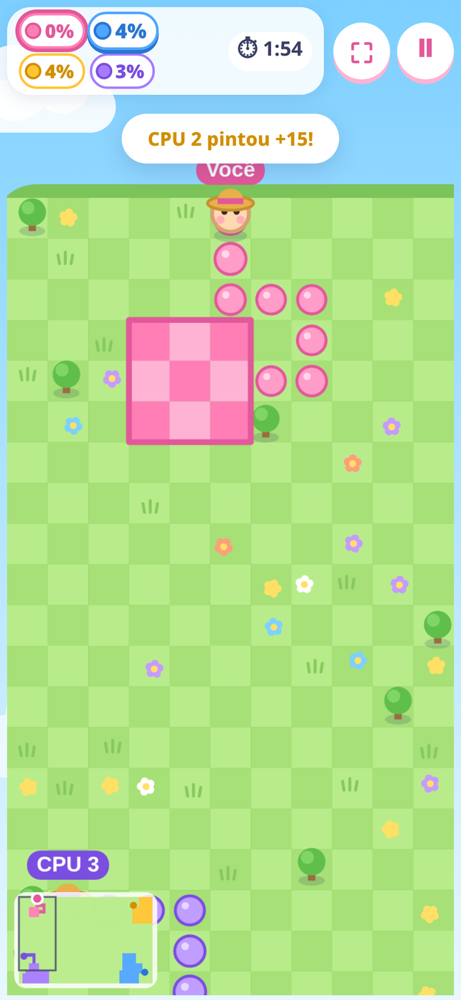

- **Deslize o dedo** em qualquer lugar da tela para mudar de direção (só para
  cima, baixo, esquerda ou direita — nada de diagonal). Vale o lado para onde o
  dedo andou mais. A virada acontece **durante** o arrasto, assim que o dedo
  anda uns 24 px, sem precisar soltar; e dá para virar **várias vezes no mesmo
  arrasto** (cada virada recomeça a medida de onde o dedo está). Meia-volta
  (180°) continua proibida. Se você pedir duas viradas bem rápidas (por
  exemplo "cima" e logo "esquerda"), a segunda acontece na célula seguinte.
- No começo da partida aparece a dica **"Deslize o dedo para mudar de
  direção"** com uma mãozinha animada; ela some na primeira virada. No
  computador a dica mostra as teclas.
- Durante a partida o navegador não rola a página, não dá zoom de pinça, não
  seleciona texto, não abre menu de toque longo e não "puxa para atualizar".
- **Câmera:** em tela pequena, a câmera **segue o seu explorador** com células
  grandes (28–40 px) e movimento suave, e aparece um **minimapa** no canto com
  os territórios, os exploradores (o seu com borda branca) e a parte que você
  está vendo. Quando o mapa inteiro cabe com células de bom tamanho (no
  computador), a câmera mostra a ilha toda.
- **Tela cheia** (⛶, quando o navegador permite — no iPhone o Safari não
  permite, mas dá para "Adicionar à Tela de Início") e **tela sempre acesa**
  durante a partida (Wake Lock, quando existe).
- **⏸ Pausa e opções:** botão grande no canto. Liga/desliga a **vibração**
  (vibra de leve ao conquistar e no "Ops!", em aparelhos que vibram) e as
  **setas na tela**. As setas ficam **escondidas por padrão**: no celular,
  deslizar é mais rápido e não tapa o jogo; quem preferir botões liga nas
  opções (a escolha fica salva no aparelho). **Esc** ou **P** pausam no
  computador.
- Funciona em **retrato e paisagem**, ocupa a tela toda (100dvh) e respeita o
  entalhe do iPhone (safe-area).
- **Offline no celular:** a configuração é simples — **Só eu**, **Contra 1
  CPU** ou **Contra 3**, com nível e cor. Vários jogadores no mesmo aparelho
  ficam em "Mais opções" (pensado para o teclado do computador).
- Se o jogo sai da tela (bloqueou o celular, trocou de app), a partida **pausa
  sozinha**; ao voltar, toque em **Continuar**.

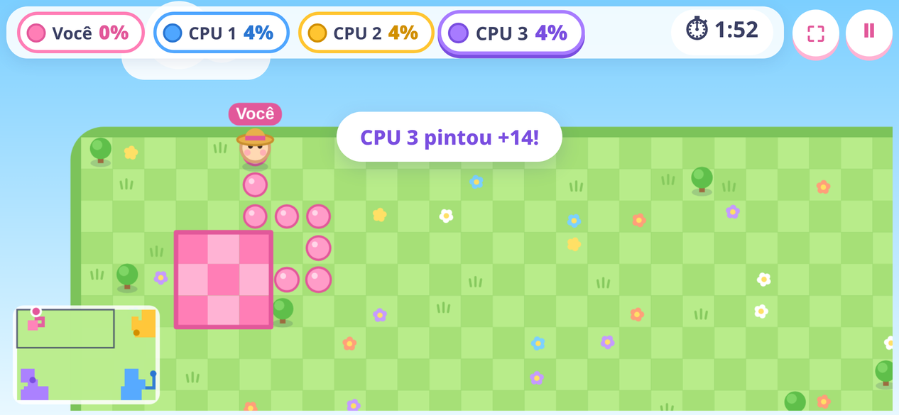

## Controles

| Vaga | Teclas |
| --- | --- |
| J1 | **W A S D** |
| J2 | **Setas** |
| J3 | **I J K L** |
| J4 | teclado numérico **8 4 5 6** *ou* **T F G H** (para quem não tem teclado numérico) |

- **Toque:** deslize o dedo (veja "No celular").
- **Online:** cada um usa **W A S D**, **setas**, deslizar o dedo ou as setas
  na tela no próprio aparelho.
- Se houver **um único humano** na partida (inclusive no solo), ele pode usar
  **W A S D**, as **setas** ou as teclas da própria vaga.
- Os **botões na tela** (▲ ◀ ▼ ▶) controlam o único humano, ou o primeiro
  humano quando há vários.
- **Enter** ou **Espaço** começam a partida / jogam de novo.

## Regras

- O explorador anda sozinho, célula a célula; a tecla escolhe a próxima direção.
- Não dá para dar meia-volta (180°). A borda do mapa faz o explorador parar.
- Fora do próprio território (na grama ou no território de outro jogador),
  cada célula visitada vira **rastro**.
- Voltando ao território, o rastro vira território e toda área cercada também
  — **inclusive território de outros jogadores**.
- **Pisou no próprio rastro?** Nada de "perder": o rastro some, o explorador
  volta ao último ponto seguro e aparece um "Ops! Tente de novo".
- **Encostou no rastro de outro jogador?** O rastro dele é cortado: o rastro
  dele some e ele volta para o território dele ("✂️ Ana cortou o rastro de Beto!").
- Dois exploradores na mesma célula: nada acontece.
- Ninguém é eliminado: quem perde todo o território ganha uma ilhinha nova 3x3
  no lugar onde começou.

## A CPU

| Nível | Velocidade | Como joga |
| --- | --- | --- |
| Fácil | 60% | voltas pequenas e, às vezes, vira para um lado qualquer |
| Médio | 72% | voltas médias; volta para casa se o rastro ficar longo ou se alguém chegar perto |
| Difícil | 78% | compara várias voltas e escolhe a maior e mais segura; persegue rastros de adversários que estejam perto (com uma pausa entre uma caçada e outra) |
| Impossível 😈 | 100% | tenta te atrapalhar: caça seu rastro com previsão, vigia, rouba território e não deixa brecha (veja abaixo) |

### Impossível 😈 (nível extra)

O "cérebro" que **tenta te atrapalhar**. Anda na **mesma velocidade** que
você e:

- **caça com previsão:** calcula o caminho que você vai fazer para voltar para
  casa e vai para o ponto do seu rastro (ou desse caminho) onde ele chega
  **antes de você chegar em casa** — se não dá para te pegar, ele nem tenta;
- **vigia** quando você sai de casa, ficando perto do seu caminho de volta;
- **rouba o seu território:** as voltas dele preferem fechar pedaços dos
  humanos e de quem está ganhando;
- **não deixa brecha:** volta para casa assim que alguém conseguiria alcançar
  o rastro dele.

Para continuar justo para crianças: prefere caçar **humanos** (numa partida só
de CPUs, caça quem estiver perto), mostra um **😈 em cima da cabeça quando está
caçando ou de olho em você** (dá tempo de fugir) e tem um **respiro de 2,5 s** depois de cortar
alguém. Os ajustes ficam em `NIVEIS.desafio` (`js/ai.js`).

Medido na simulação (partidas de 2 min, um "humano robô" na velocidade de
gente contra a CPU): o Difícil corta o rastro do robô 0,2–0,5 vez por partida;
o Impossível corta **9 a 12 vezes** e derruba o território dele de ~30% para
15–23%. Jogando com a estratégia simples de **voltas curtas e voltar para casa
quando o 😈 chega perto**, o robô "esperto" vence o Impossível em **26 de 100**
partidas no 1x1, **0 de 100** com 3 jogadores (+ Difícil) e **1 de 100** com 4
(+ Difícil + Médio). Um robô treinado por algoritmo genético, na mesma velocidade
de gente, vence **100/100**, **75/100** e **41/100**. Ele ensina três coisas:
volte para casa assim que o 😈 conseguiria alcançar o seu rastro antes de você
chegar em casa; faça voltas grandes e bem escolhidas; não fique vigiando ninguém.
Detalhes em [`tests/genetico/RELATORIO.md`](tests/genetico/RELATORIO.md).

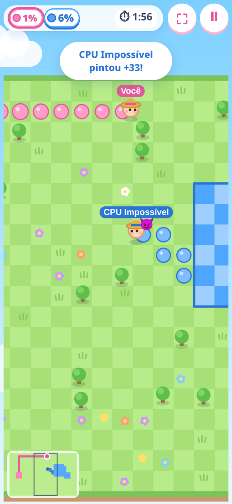

A CPU planeja voltas em forma de retângulo e, a cada passo, só aceita
direções que ainda têm um caminho de volta para casa sem cruzar o próprio
rastro (busca em largura). Por isso os níveis Médio e Difícil nunca pisam no
próprio rastro por descuido. As CPUs Fácil, Médio e Difícil são um pouco mais
lentas que um humano, para continuar vencíveis por uma criança. O Impossível 😈
anda na mesma velocidade que você (100%) e fica justo por outros meios: avisa
com o 😈, tem o respiro depois de cortar e prefere caçar a seguir.

## Como o código está organizado

Os scripts são `<script>` clássicos (não módulos ES) para o jogo abrir direto
em `file://`. Tudo fica no namespace global `window.IlhasDeTinta`.

```
index.html            página, canvas, HUD e telas (configuração / fim)
css/style.css         visual da página e da interface (céu, nuvens, HUD, botões)
js/config.js          constantes: tamanhos de mapa, cores dos jogadores, níveis da CPU,
                      controles de cada vaga, velocidade, metas e tempo
js/grid.js            estado do mapa (dono e rastro por célula), captura por flood fill,
                      porcentagem por jogador e busca de caminho (BFS)
js/player.js          o explorador: posição, direção, movimento célula a célula
js/input.js           teclado (um esquema por vaga) + botões direcionais na tela
js/renderer.js        desenho da ilha, decoração, territórios, rastros, exploradores e confete
js/ui.js              HUD (solo e multi), relógio, mensagens e tela de fim com ranking
js/ai.js              a CPU (Fácil, Médio, Difícil)
js/setup.js           tela de configuração dos jogadores (offline)
js/online.js          modo online: salas, Presence, anfitrião e sincronização
js/turma.js           turma fixa (?turma=), turmas salvas, nome/cor lembrados, QR e manifest da turma
js/vendor/            supabase-js 2.119.0 e qrcode-generator 1.4.4 (cópias locais, versões fixas)
sw.js                 service worker (cache para funcionar sem internet)
manifest.webmanifest  dados para instalar o jogo como aplicativo
icones/               ícones do jogo (SVG e PNG)
js/instalar.js        instalar como app (botão, dica do iPhone, atalhos, convite, atualização)
js/som.js             efeitos sonoros gerados na hora (Web Audio)
js/tutorial.js        primeira partida guiada ("Como jogar")
vercel.json           cabeçalhos de cache para a hospedagem
js/game.js            loop (requestAnimationFrame), regras e estados:
                      menu → configuração/online/sala → jogando → fim
tests/captura.html    testes da captura de área (abra no navegador)
tests/simulacao.html  partidas automáticas com CPUs + teste dos controles
tests/online.html     teste online de ponta a ponta (2 ou 4 janelas, Supabase real)
tests/celular/        testes com toque de verdade e celular x desktop (Python + Chrome)
tests/teste_turma.js  turma fixa e QR (Node)
tests/genetico/       teste oculto: robô treinado por algoritmo genético × Impossível,
                      e o modo depuração (?robo=campeao&debug=1) — veja RELATORIO.md
docs/screenshots/     capturas de tela
```

### Como funciona a captura

Cada célula guarda o **dono** (0 = grama, 1 a 4 = jogador) e o **rastro**
(0 = nenhum, 1 a 4 = jogador). Quando o jogador *N* volta ao território com
rastro (`Grade.capturar(N)` em `js/grid.js`):

1. todo o rastro de *N* vira território de *N*;
2. um flood fill (busca em largura) parte das bordas do mapa e anda só por
   células que **não** são de *N* (território de outros não é parede);
3. toda célula que não é de *N* e não foi alcançada está cercada, então vira
   de *N* — mesmo que fosse de outro jogador.

### Testes

- `tests/captura.html` — abra no navegador (funciona com duplo clique). Testa
  área simples, forma em L, captura encostada na borda, área aberta para a
  borda, rastro que não fecha área, tomada de território de outro jogador,
  rastro por cima do território alheio, busca de caminho etc.
- `tests/simulacao.html` — precisa do servidor local
  (`python3 -m http.server` e abrir <http://localhost:8000/tests/simulacao.html>).
  Confere os controles de cada vaga e roda partidas aceleradas (1 humano
  parado + CPU de cada nível, 3 e 4 CPUs): a partida precisa terminar, sem
  erros, e as CPUs Médio e Difícil não podem pisar no próprio rastro.

- `tests/online.html` — precisa do servidor local **e de internet**
  (<http://localhost:8000/tests/online.html>, ou `?jogadores=4`). Abre o jogo
  em 2 ou 4 janelinhas, cada uma como um aparelho: cria a sala, entra pelo
  código, troca de cor, completa com CPU, joga até o ranking (confere que o
  mapa e o ranking são iguais em todas as janelas), "Jogar de novo", um
  jogador saindo no meio (vira CPU) e o anfitrião saindo (todos voltam ao menu).

- `tests/celular/teste_instalar.py` — confere que o Chrome considera o site
  instalável, o botão Instalar, a dica do iPhone, o modo instalado, os atalhos
  e a atualização segura (só recarrega fora da partida).
- `tests/celular/medir_online.py 2|4` — mede uma partida online de verdade:
  mensagens por tipo (o que o Supabase conta) e o atraso da virada (issue #5 e
  #7).
- `tests/celular/teste_quedas.py` — **quedas e reconexão de verdade** (issue
  #6): congela a aba (`Page.setWebLifecycleState`), derruba o WebSocket e
  desliga a rede (`Network.emulateNetworkConditions`), recarrega a página.
  Anfitrião e cliente somem por 5 s, 20 s e além da tolerância, na sala de
  espera e no meio da partida; também testa quem chega no meio (espectador) e
  "Voltar para a sala".
- `tests/celular/teste_convite.py` — o desktop cria a sala e convida; o
  celular abre o link e entra com um toque (e, com o nome lembrado, entra direto).
- `tests/celular/medir_lag.py [atraso_ms] [variacao_ms] [cpu_lenta]` — mede o
  "lag" de quem não é o anfitrião numa partida real. Com atraso de rede e
  celular lento simulados, compara a cada 50 ms onde cada explorador aparece
  no cliente com onde ele está no anfitrião. Mostra:
  - os puxões para trás;
  - as correções;
  - quanto o personagem fica sem rastro embaixo;
  - as viradas exatas, rebobinadas, guardadas ou atrasadas no anfitrião.
- `tests/celular/teste_turma.py` — **turma fixa** com 4 aparelhos (2
  computadores e 2 celulares, Supabase real):
  - quem cria vira o anfitrião;
  - o QR na tela, lido com o jsQR, dá o link certo;
  - sem nome lembrado, entra só escrevendo o nome;
  - com nome lembrado, entra direto e com a cor preferida (ou outra livre, se
    estiver ocupada);
  - trocar nome; turma salva no menu; espectador no meio da partida;
  - todos saem e reabrir o link cria a sala de novo;
  - duas pessoas abrindo uma turma vazia ao mesmo tempo acabam numa sala só;
  - manifest da turma para "Adicionar à tela inicial".

  Com `docs/screenshots` como argumento, refaz as fotos `turma-*.png`.
- `node tests/teste_turma.js` — sem navegador:
  - ids de turma;
  - lista de turmas, nome e cor lembrados (também com o `localStorage` bloqueado);
  - o QR do jogo lido de volta pelo jsQR (`tests/vendor/jsQR-1.4.0.js`,
    usado só nos testes).
- `tests/celular/` — testes com **toque de verdade** no Chrome headless
  (celular emulado, `Input.dispatchTouchEvent`) e uma partida online real
  **celular × desktop** trocando quem é o anfitrião. Precisa de `python3` e
  `google-chrome`; veja `tests/celular/LEIAME.md`.

A página fica verde quando tudo passa.

**Testes em Node** (`tests/genetico/`). Precisam do Node 26, que está em
`~/.local/bin/node` (`export PATH=$HOME/.local/bin:$PATH`), e não usam
dependências npm. O jogo continua sem build.

- `node tests/genetico/teste_depuracao.js`: joga 36 partidas com e sem o modo
  depuração e exige o mesmo mapa final. Também exige que o log explique uma fuga
  por perigo, uma caçada e a escolha de uma volta.
- `node tests/genetico/conferir.js`: roda 6 partidas no simulador Node (a lógica
  real do jogo). O resultado tem de ser idêntico ao de `tests/genetico/conferir.html`
  aberto no navegador pelo servidor local.
- `node tests/genetico/treinar.js --cenario 1x1` (ou `3j`, `4j`): treina o robô
  pelo algoritmo genético (13–30 min com 15 núcleos).
  `node tests/genetico/validar.js --cenario 1x1` mede o robô em 100 partidas
  novas, com intervalo de confiança.
- `node tests/genetico/registrar.js --log partida.json --texto`: grava o log de
  decisões de uma partida (o mesmo JSON do `?debug=1`).
- `python3 tests/genetico/teste_depuracao_tela.py http://localhost:8000/`: testa
  o modo depuração no Chrome.

**Robôs de teste** são "humanos de mentira": andam na velocidade de uma pessoa
e só escolhem direções.
- **esperto:** faz voltas curtas e volta quando alguém chega perto.
- **cuidadoso:** usa o cérebro do nível Médio.
- **descuidado:** usa o cérebro do nível Fácil.
- **campeão:** foi treinado pelo algoritmo genético.

Para assistir: `index.html?robo=campeao` ou `index.html?robo=esperto`. Acrescente
`&debug=1` para ver as decisões.

**Teste oculto: o Impossível é vencível? E o que o robô pensa?** Em
`tests/genetico/` há um robô treinado por algoritmo genético. Para assisti-lo:
`index.html?robo=campeao`. Com `&debug=1`, aparecem as decisões dele (balão,
desenhos no mapa, painel com o log e o ranking das voltas, pausa/passo e
"Baixar log (JSON)"). Só `?debug=1` mostra as decisões da CPU Impossível numa
partida normal. Nada disso aparece no menu. Números, como rodar e o formato do
log estão em [`tests/genetico/RELATORIO.md`](tests/genetico/RELATORIO.md).

### Ajustes rápidos

Em `js/config.js` dá para mudar os tamanhos de mapa, a velocidade, as cores,
as metas e o tempo. Para testar o fim rapidinho, no console do navegador
(antes de apertar Jogar):

```js
IlhasDeTinta.config.META = 0.05;          // solo
IlhasDeTinta.config.META_MULTI[2] = 0.05; // 2 jogadores
IlhasDeTinta.config.TEMPO_LIMITE = 15;    // partida de 15 segundos
```

## Limitações conhecidas

- **Online — anfitrião fora da tela:** a partida fica parada esperando por até
  30 s (tolerância) e depois outro jogador assume (veja "Troca de anfitrião").
  Quem assume continua do último estado que recebeu (até ~0,1 s antes de o
  anfitrião sumir; imperceptível na prática).
- **Online — celular bloqueado por muito tempo:** o Safari/Chrome do celular
  congelam a página; ao voltar, ela reconecta. Se a pessoa ficou fora mais que
  a tolerância, volta como jogador comum (ou espectador, se a partida acabou e
  começou outra sem ela).
- **Som:** o navegador só deixa tocar som depois do primeiro toque/tecla; no
  iPhone, o botão lateral de silencioso também cala o jogo.
- **Celular:** a vibração não existe no iPhone (Safari) e a tela cheia
  também não; o Wake Lock só funciona em navegadores que o suportam (no iPhone,
  iOS 16.4+). Vários jogadores no mesmo celular não é suportado de forma
  confortável (é pensado para o teclado do computador).
- **Online — atraso:** a virada de quem não é anfitrião aparece na hora na
  tela dele (previsão), e o anfitrião a aplica na célula certa até ~0,85 s de
  atraso (rebobina até 6 células). Com mais atraso, a virada sai depois e a
  previsão desliza para a posição certa. Os **outros** exploradores aparecem
  um pouco atrás de onde estão de verdade, pelo tempo da internet. Isso é
  normal, e eles seguem em linha reta até a próxima mensagem.
- **Online — confiança:** como o anfitrião simula tudo no navegador dele, quem
  souber mexer no console poderia trapacear. Para um jogo entre amigos e
  família isso é aceitável.
- **Online — quem chega no meio** de uma partida só assiste até a próxima
  (escolha mais simples e justa para crianças: ninguém ganha território "de
  graça" no meio).
- **Online — limites do plano grátis** (veja a tabela acima): no máximo **2
  salas de 4 jogadores** (ou ~6 de 2) jogando ao mesmo tempo, e ~470 partidas
  de 4 por mês.
- **Sem internet:** só funciona depois de abrir o site uma vez com internet; o
  modo Online sempre precisa de internet. Ao atualizar o jogo é preciso
  aumentar `VERSAO` no `sw.js`.

- A borda do mapa não funciona como parede na captura: uma área só é capturada
  se ficar totalmente cercada pelo território (como pede a regra do flood fill
  a partir das bordas). Para conquistar perto da borda, o rastro precisa passar
  pelas células da própria borda.
- Com 3 ou 4 jogadores no mesmo teclado, alguns teclados não registram muitas
  teclas apertadas ao mesmo tempo (limitação do hardware, "ghosting").
- Em telas de celular o mapa encolhe para caber na largura, então as células
  ficam pequenas; o modo com vários humanos foi pensado para teclado.
- Se dois exploradores entram na mesma célula com rastro, ninguém é cortado;
  o rastro de quem chegou depois fica com um "buraco" naquela célula, o que
  pode deixar escapar a captura daquela volta (caso raro).
- O equilíbrio da CPU foi ajustado por simulação, não com crianças de
  verdade: pode ser preciso mexer nas velocidades em `js/config.js`.
- Sem sons, inimigos, power-ups ou fases extras: é um protótipo só com o básico.
