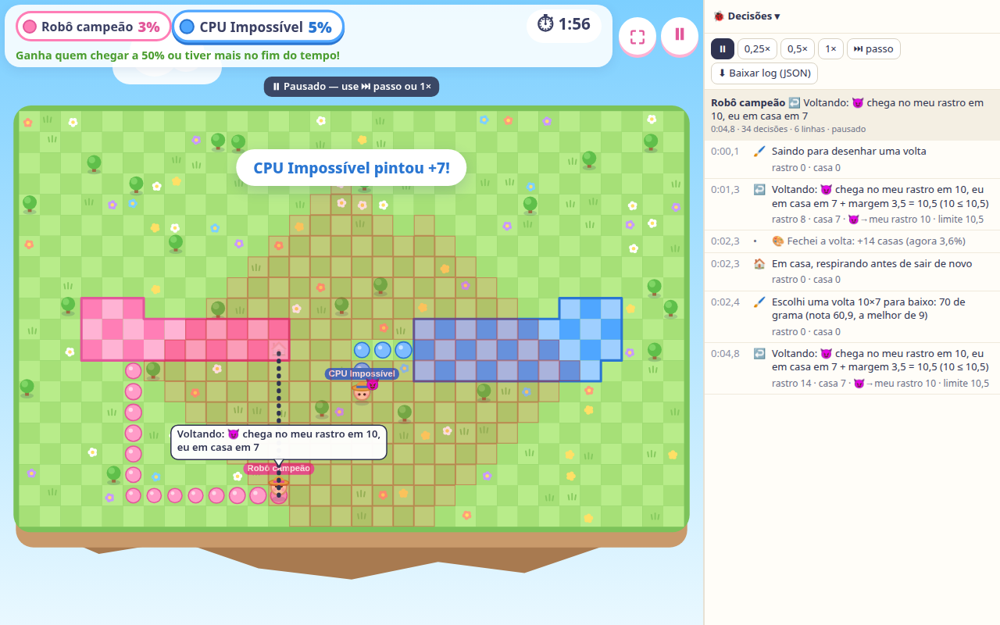
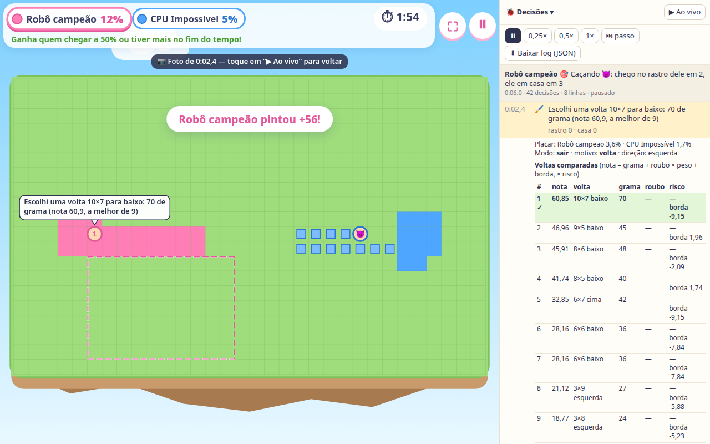

# Dá para vencer o Impossível 😈? — relatório do algoritmo genético

**Resposta curta: dá.** Um robô que joga como uma pessoa (mesma velocidade, só
escolhe direções) e que foi treinado por um algoritmo genético vence a CPU
Impossível em **100 de 100** partidas novas no 1x1. Com 3 jogadores vence
**75 de 100**, e com 4 jogadores vence **41 de 100** (mais que qualquer outro
robô testado; o 1º lugar costuma ficar entre ele e a CPU Difícil). O
Impossível não é imbatível em nenhum dos cenários. No 1x1, o que decide é
**voltar para casa antes que o Impossível consiga alcançar o rastro**, e não
caçar. Com mais jogadores, o que pesa são **voltas grandes, bem escolhidas e
nunca ficar vigiando**.

Tudo isto é teste oculto: nada aparece no menu e o modo Impossível continua
exatamente igual.

## Números (validação em 100 partidas nunca vistas no treino)

As partidas de validação usam as sementes 9.000.000 a 9.000.099, e todos os
robôs jogam as mesmas partidas. "IC95" é o intervalo de confiança de Wilson de
95% para a taxa de vitória. "Território" é a média, no fim da partida, do
robô × do melhor adversário.

| Cenário | Robô | Vitórias | IC95 | Território |
|---|---|---|---|---|
| **1x1** (× Impossível) | **campeão genético** | **100/100** | 96–100% | 50,7% × 11,2% |
| | robô esperto (fixo) | 26/100 | 18–35% | 30,4% × 43,1% |
| | robô cuidadoso (cérebro Médio) | 4/100 | 2–10% | 24,1% × 48,2% |
| | robô sem treino (genes 0,5) | 3/100 | 1–9% | 13,7% × 44,4% |
| | CPU Difícil no lugar do J1 | 0/100 | 0–4% | 14,0% × 51,7% |
| **3j** (× Impossível + Difícil) | **campeão genético** | **75/100** | 66–83% | 33,4% × 25,7% |
| | robô esperto | 0/100 | 0–4% | 19,9% × 36,1% |
| | robô cuidadoso | 2/100 | 1–7% | 20,8% × 35,5% |
| | robô sem treino | 4/100 | 2–10% | 16,8% × 31,0% |
| | CPU Difícil no lugar do J1 | 63/100 | 53–72% | 31,3% × 27,0% |
| **4j** (× Impossível + Difícil + Médio) | **campeão genético** | **41/100** | 32–51% | 27,7% × 30,3% |
| | robô esperto | 1/100 | 0–5% | 15,6% × 35,3% |
| | robô cuidadoso | 10/100 | 6–17% | 18,6% × 34,4% |
| | robô sem treino | 3/100 | 1–9% | 13,2% × 34,2% |
| | CPU Difícil no lugar do J1 | 30/100 | 22–40% | 23,9% × 30,2% |

Arquivos: `resultados/<cenário>/validacao.json`, `campeao.json`,
`historico.json` (uma linha por geração), `ablacao.json` e `evolucao.svg`
(gráfico da aptidão e das vitórias por geração).

## Cenários (composição)

O robô é sempre o J1 (rosa, tipo "humano", velocidade 1). As vagas e os mapas
são os do jogo: 32×20 com 2 jogadores e 40×26 com 3 ou 4. A meta de território
é 50% no 1x1 e 35% com 3 ou 4 jogadores, e a partida tem 2 minutos.

| Cenário | Adversários |
|---|---|
| `1x1` | CPU Impossível 😈 (azul) |
| `3j` | CPU Impossível (azul) + CPU Difícil (amarelo) |
| `4j` | CPU Impossível (azul) + CPU Difícil (amarelo) + CPU Médio (roxo) |

"Vencer" significa terminar em 1º lugar sozinho (empate não conta). Isso vale
tanto quando alguém atinge a meta quanto quando o tempo acaba.

## O que o campeão aprendeu

O robô usa o mesmo "cérebro" das CPUs (`js/ai.js`): planeja voltas em
retângulo, volta para casa por BFS sem pisar no próprio rastro, e pode caçar ou
vigiar com previsão. Cada um dos 14 genes regula um desses comportamentos. A
ablação tira um comportamento de cada vez e mede o resultado nas mesmas 60
partidas novas (`ablacao.js`):

| Mudança no campeão | 1x1 vence | 3j vence | 4j vence |
|---|---|---|---|
| campeão como está | 60/60 | 51/60 | 22/60 |
| não caça (alcanceCaca 0) | 60/60 | 48/60 | 23/60 |
| sem margem de segurança (margem 0) | 50/60 | 39/60 | 32/60 |
| margem de segurança do Impossível (1) | 59/60 | 47/60 | 22/60 |
| nunca foge pelo perigo (margem -2) | 40/60 | 46/60 | 25/60 |
| voltas pequenas (prof. 3, lado 4, rastro 10) | 41/60 | 4/60 | 5/60 |
| rastro curto (rastroMax 12) | 60/60 | 42/60 | 20/60 |
| escolhe a 1ª volta (candidatos 1) | 45/60 | 27/60 | 16/60 |
| roubar = grama (pesoRoubo 1) | 58/60 | 46/60 | 24/60 |
| medo do robô esperto (6) | 59/60 | 43/60 | 20/60 |
| vigia o adversário (vigia 6) | 34/60 | 3/60 | 2/60 |

Cada cenário usa o próprio campeão. No 4j, com 60 partidas, diferenças de até ~8 vitórias são ruído: a variante "margem 0" (32/60) fez só 33/100 nas sementes de validação, contra 41/100 do campeão.

1. **Não deixar brecha é o que decide.** O campeão do 1x1 volta para casa
   assim que o Impossível conseguiria chegar ao rastro dele até **~3,5 passos
   antes** de ele estar em casa. É uma margem maior que a do próprio
   Impossível (1 passo). Com a margem do Impossível, o rastro é cortado 8,6
   vezes por partida em vez de 2,4; com margem 0, 13 vezes, e a taxa de
   vitória cai de 60/60 para 50/60. Quem nunca foge cai para 40/60.
2. **Voltas grandes, escolhidas com cuidado.** O campeão faz voltas de até
   7×9 casas (1x1) ou 8×10 (3j), com rastro de até 31–35 casas, e compara de 9
   a 10 voltas possíveis antes de sair. Voltas pequenas (o que o robô
   "esperto" faz) seguras demais rendem pouco: no 3j vencem só 4/60. Pegar a
   primeira volta que aparece (candidatos 1) derruba para 45/60 e 27/60.
3. **Caçar ajuda pouco.** O campeão corta o Impossível ~6 vezes por
   partida, mas sem caçar ele ainda vence 60/60 no 1x1 e 48/60 no 3j.
4. **Vigiar é péssimo.** Ficar perto do caminho de volta do adversário
   (o que o Impossível faz) deixa o robô fora de casa com rastro e o faz perder:
   34/60 no 1x1 e 3/60 no 3j.
5. **Medo por distância não serve.** O "medo" do robô esperto (voltar
   quando alguém chega a 6 casas) praticamente não muda o resultado do
   campeão, porque a margem de segurança faz o mesmo papel com mais precisão
   (ela calcula quem chega primeiro, em vez de olhar só a distância).
6. **Com 3 ou mais jogadores, o rival de verdade não é o Impossível.** O
   Impossível persegue humanos. Enquanto ele gasta tempo atrás do robô, a CPU
   Difícil cresce. No 3j, quando o campeão perde, quem ganha é a Difícil (23 de
   100); o Impossível só ganhou 2 de 100. Contra o robô esperto, a Difícil venceu
   38 de 40. No 4j, das 100 partidas do campeão, a Difícil venceu 54, o robô
   41, a Médio 4 e o Impossível só 1. Por isso a CPU Difícil no lugar do J1
   (que o Impossível não prefere caçar) vence 63% no 3j, 30% no 4j e 0% no 1x1.
7. **Quanto mais gente, menos a margem de segurança pesa, e mais pesam as
   voltas grandes.** No 4j, voltas pequenas caem para 5/60 e vigiar para 2/60,
   enquanto mudar a margem quase não faz diferença.

Os campeões dos três cenários chegaram a parâmetros parecidos (voltas de 7–8
× 9–11, rastro máximo de 31–35, 9–10 candidatos, caça até 6–9 casas, sem vigiar,
medo 2). A diferença é a margem de segurança: ~3,5 no 1x1 e ~1,5 com mais
jogadores.

**Para uma criança**, a lição é: faça voltas grandes, mas volte para casa
**assim que** o Impossível estiver mais perto do seu rastro do que você está
de casa. Não fique esperando ele chegar perto.

## Como rodar

O Node está em `~/.local/bin` e não há dependências npm. O jogo não muda: ele
continua sem build e abrindo com duplo clique.

```sh
export PATH=$HOME/.local/bin:$PATH
node tests/genetico/treinar.js --cenario 1x1      # ou 3j, 4j (opções: --populacao 60 --geracoes 50 --partidas 16 --workers N --continuar)
node tests/genetico/validar.js --cenario 1x1      # 100 partidas novas, IC de Wilson → validacao.json
node tests/genetico/ablacao.js --cenario 1x1      # o que pesa no campeão → ablacao.json
node tests/genetico/grafico.js --cenario 1x1      # evolucao.svg
node tests/genetico/campeoes.js                   # junta os campeões em resultados/campeoes.js (para assistir)
node tests/genetico/conferir.js                   # compare com tests/genetico/conferir.html no navegador
```

Tempo com 15 workers (16 núcleos), população 60, 50 gerações e 16 partidas por
geração: 1x1 em 13 min, 3j em 20 min, 4j em 30 min. Um treino interrompido
continua com `--continuar` (lê `resultados/<cenário>/checkpoint.json`, que não
vai para o git).

## Como assistir

Abra o jogo com `?robo=campeao` (vale também no site publicado):

- `index.html?robo=campeao`: campeão do 1x1 × Impossível;
- `index.html?robo=campeao&cenario=3j` ou `&cenario=4j`: campeão daquele cenário;
- `index.html?robo=esperto`: o robô fixo "esperto", para comparar.

"Jogar de novo" começa outra partida com o mesmo robô. O gancho são 5 linhas no
`game.js`, que só carregam `tests/genetico/assistir.js` quando a URL tem
`?robo=`. Sem esse parâmetro, o jogo é exatamente o de antes.

## Modo depuração: o que o robô decidiu e por quê

Abra o jogo com `&debug=1` (também vale no site publicado):

- `index.html?robo=campeao&debug=1`: robô campeão (1x1) contra o Impossível;
- `index.html?robo=campeao&cenario=3j&debug=1` (ou `4j`);
- `index.html?debug=1`: jogo normal pelo menu, mostrando as decisões da CPU
  Impossível (ou da primeira CPU; `&quem=3` escolhe o jogador 3).

Sem `debug=1` nada disso é carregado e o jogo é exatamente o de sempre.

**No mapa:**
- **retângulo tracejado**: a volta planejada;
- **pontilhado até a 🏠**: o caminho de volta para casa (sem pisar no próprio
  rastro);
- **mira vermelha**: o ponto onde vai cortar alguém, quando está caçando;
- **👁️**: onde fica de vigia;
- **área avermelhada**: até onde os adversários chegam antes de o robô
  conseguir voltar para casa (passos até casa + margem). Se o rastro dele
  estiver dentro dela, ele volta.

Um **balão** em cima do robô mostra a decisão de agora, com os números do
momento, por exemplo "Voltando: 😈 chega no meu rastro em 6, eu em casa em 3".

**Painel de decisões** (à direita; no celular fica embaixo e começa
recolhido; toque em "🐞 Decisões" para abrir):
- uma linha por **mudança** de decisão ou por evento (pintou, cortou, foi
  cortado), com o tempo da partida, a frase e os números (rastro, passos até
  casa, passos de cada adversário até o meu rastro e o limite);
- ao tocar numa linha, ela abre o placar daquela hora, a tabela "adversário ×
  passos até meu rastro" e, se a linha for a escolha de uma volta, o
  **ranking das voltas comparadas** com a nota e os componentes de cada uma
  (grama, roubo de quem, borda, risco). O mapa mostra a **foto** daquele
  momento com os desenhos da hora; "▶ Ao vivo" volta;
- controles: ⏸, 0,25×, 0,5×, 1× e **⏭ passo** (avança até a próxima
  decisão, uma célula). No teclado, `.` faz o mesmo;
- **⬇ Baixar log (JSON)**: salva o log da partida.




Mais fotos de tela: `docs/screenshots/debug-volta.png`, `debug-cacada.png`,
`debug-celular.png` e `debug-celular-recolhido.png`.

**Sem navegador** (mesmo JSON):

```sh
node tests/genetico/registrar.js --log partida.json --texto          # robô campeão 1x1, semente 9000000
node tests/genetico/registrar.js --log p.json --cenario 3j --semente 9000005
node tests/genetico/registrar.js --texto --robo esperto --sujeito 2  # decisões do Impossível
```

Linhas reais (robô campeão 1x1, semente 9000000):

```
0:00,0  Escolhi uma volta 7×10 para a direita: 70 de grama (nota 60,9, a melhor de 9)
0:01,1  Voltando: 😈 chega no meu rastro em 10, eu em casa em 8 + margem 3,5 = 11,5 (10 ≤ 11,5)
0:02,2  🎨 Fechei a volta: +14 casas (agora 3,6%)
0:04,8  Caçando 😈: chego no rastro dele em 5, ele em casa em 8
0:05,5  ✂️ Cortei o rastro de 😈
0:05,5  Cortei! Descanso 2,5 s antes de caçar de novo
0:09,3  Escolhi uma volta 10×6 para baixo: 50 de grama + 10 de 😈, com adversário perto (nota 51,1, a melhor de 9)
0:17,8  Caçando 😈: chego no caminho de volta dele em 2, ele em casa em 2,9
0:18,0  Parei de caçar: não chego a tempo em ninguém
```

E do Impossível (`--sujeito 2`): "De olho no caminho de volta de Robô (estou a
24 passos)".

### Formato do JSON

```js
{
  formato: 'ilhas-de-tinta/depuracao', versao: 1,
  sujeito: { id, nome, tipo, dificuldade },   // de quem é o log
  parametros: { ... },                         // genes decodificados (robô) ou nível (CPU)
  mapa: { colunas, linhas },
  jogadores: [{ id, nome, tipo, dificuldade, cor, velocidade }],
  decisoes: 638,                               // vezes que o cérebro decidiu (uma por célula)
  cenario, semente, robo, resultado,           // só no Node (registrar.js); no navegador: url
  entradas: [
    { n, t,                                    // nº da linha e segundos de partida
      tipo: 'decisao',
      modo: 'casa' | 'sair' | 'voltar' | 'cacar' | 'vigiar',
      motivo: 'volta' | 'semVolta' | 'espera' | 'rastroMax' | 'medo' | 'fimDaVolta' | 'perigo'
            | 'corte' | 'vigia' | 'respiro' | 'fimCaca' | 'caca' | 'inalcancavel' | 'reinicio' | 'inicio',
      frase: 'Voltando: 😈 chega no meu rastro em 10, …',
      numeros: { rastro, casa,                 // tamanho do rastro; passos até casa
                 folga, limite,                // margem; (casa + margem) / velocidade
                 adversarios: [{ id, nome, apelido, passos, tempo }] },  // até o MEU rastro
      detalhe: { tipo, … },                    // o motivo cru do ai.js. Ex.: perigo → detalhe.adversarios[].alcanca;
                                               // corte → corte: { x, y, passos, alvo, tempoDele, onde: 'rastro'|'caminho' }
      direcao: 'cima', posicao: [x, y],
      placar: [{ nome, pct }],
      candidatos: [                            // só quando escolheu uma volta (motivo 'volta')
        { posicao: 1, escolhida: true, nota: 60.85, direcao: 'direita', lado: 'cima',
          largura: 7, altura: 10, retangulo: { x0, y0, x1, y1 }, area: 70,
          grama: 70, roubo: [{ de: '😈', casas: 12 }], borda: -9.15,
          antesDoRisco: 60.85, risco: false, adversarioMaisPerto: 22, raioDeRisco: 11.31, fatorRisco: 1 } ],
      foto: { donos: '000…', rastros: '000…',  // um dígito (0–4) por célula, linha a linha
              jogadores: [{ id, x, y }],
              desenhos: { plano: { x0, y0, x1, y1, pontos }, caminhoCasa: [[x, y], …],
                          mira: [x, y], vigia: [x, y], perigo: [índice, …] } } },
    { n, t, tipo: 'evento', evento: 'pintou' | 'cortei' | 'cortado' | 'proprio', frase, placar, foto }
  ]
}
```

`registrar.js --sem-fotos` tira as fotos (o log de uma partida cai de ~700 KB para ~260 KB).

**Garantia de que não muda o jogo:** o registro só lê o estado do jogo. Ele
não sorteia nem mexe no mapa. Os trechos novos do `ai.js` só guardam o motivo
e os componentes das notas. `node tests/genetico/teste_depuracao.js` joga 36
partidas (robô campeão, robô esperto e o Impossível como sujeito, em 1x1, 3j e
4j) com e sem registro, e o mapa final sai idêntico em todas; o teste também
exige no log uma fuga por perigo, uma caçada e a escolha de uma volta.
`python3 tests/genetico/teste_depuracao_tela.py http://localhost:8000/ --fotos`
confere o modo na tela (sem `debug` nada aparece; pausa; passo = uma decisão;
ranking; foto; 3j; só `?debug=1`; celular) e refaz as fotos de tela.

## Como funciona

- **Simulador** (`simulador.js`): carrega os arquivos reais `config.js`,
  `grid.js`, `player.js`, `ai.js` e `game.js` num `vm` do Node, com tela, desenho
  e som trocados por "nada". O passo de tempo é fixo (1/60 s) e o `Math.random`
  vem de um gerador com semente (mulberry32), sorteado depois de montar a
  partida. Uma partida leva ~0,1 s (1x1) a ~0,4 s (4j).
- **Conferência com o navegador**: `conferir.html` roda as mesmas 6 partidas
  (3 cenários, campeão e robô esperto) no jogo de verdade dentro do Chrome, e
  `conferir.js` roda as mesmas partidas no Node. A "impressão digital" do mapa
  final e as células de cada jogador bateram nas 6.
- **Robô** (`robo.js`): o J1 continua sendo um humano (velocidade 1) e só
  chama `pedirDirecao`, como o teclado. Os 14 genes (0 a 1) viram parâmetros
  do cérebro: tamanho e quantidade de voltas, rastro máximo, medo, margem de
  segurança, caça, respiro, vigia, peso de roubar território, preferência por
  borda, cautela, espera em casa e raio de perigo. O robô não ganha
  velocidade nem informação extra além do que o mapa mostra.
- **Algoritmo genético** (`genetico.js`, `treinar.js`, `piscina.js`,
  `trabalhador.js`):
  - população de 60, seleção por torneio de 3, cruzamento BLX-α (α = 0,3)
    com chance de 90%, mutação gaussiana (20% dos genes, σ caindo de 0,2 para
    0,04) e elitismo de 3;
  - aptidão = média em 16 partidas com sementes **novas a cada geração**, para
    o robô não decorar mapas. Cada partida vale 1 se vencer (0,5 se empatar),
    mais a diferença de território para o melhor adversário, menos 0,02 por
    rastro cortado;
  - as partidas rodam em paralelo com `worker_threads`, e um checkpoint é
    gravado a cada geração;
  - o campeão sai de 18 finalistas (os 8 melhores da última geração mais o
    melhor de cada uma das 10 últimas), reavaliados em 40 partidas novas;
  - para o futuro, `genetico.js` não sabe nada do jogo e `jogarPartida`
    aceita qualquer robô no J1. Co-evolução (evoluir também um Impossível) ou
    um "treinador" que ensina a criança cabem sem mudar o simulador.

## Limitações

- O robô decide a cada célula, sem demora e sem errar de tecla. Uma criança
  reage mais devagar, então os números são um **teto**: mostram que vencer é
  possível e como, não que seja fácil.
- O robô só escolhe entre comportamentos que o `ai.js` já sabe fazer, com
  parâmetros diferentes. Estratégias totalmente novas ficam fora do alcance.
- Cada cenário tem uma composição fixa (com 3 e 4 jogadores, o Impossível vem
  com Difícil e Médio). Outras misturas, como dois Impossíveis, não foram
  testadas.
- Partidas online não entram no teste: nelas o anfitrião roda a mesma
  lógica, mas há atraso de rede.
- As taxas valem para as sementes de validação. Com 100 partidas, o
  intervalo de confiança tem cerca de ±8 pontos no meio da escala.
